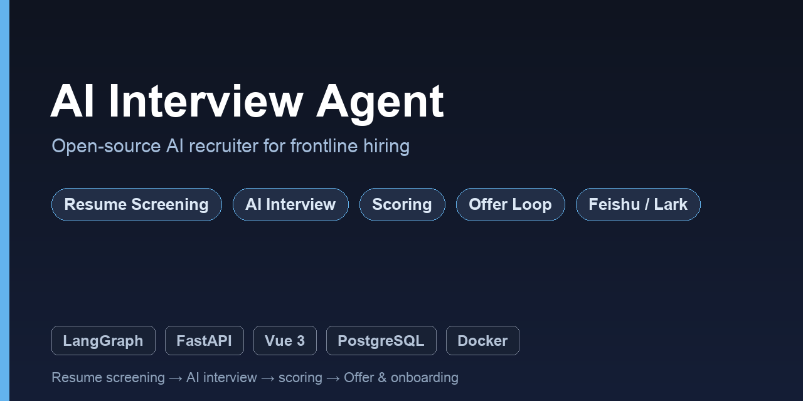
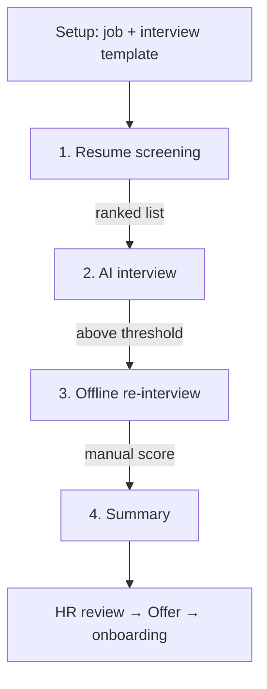

# AI Interview Agent · 智能招聘闭环系统

> **Open-source AI recruiter** that automates the full hiring loop for restaurants, stores and high-volume frontline teams: **resume screening → AI interview → structured scoring → Offer & onboarding**, with **Feishu / Lark** HR notifications.
>
> 面向餐饮门店一线招聘的开源 **AI 招聘 Agent（recruitment automation）**：候选人通过 AI Agent 多轮对话完成面试，系统逐题结构化评分；HR 在后台完成简历初筛 → AI 面试 → 线下复试 → 汇总落库，并在达标时自动推送飞书；最后补齐 Offer → 入职闭环。

[](LICENSE)
[](https://www.python.org)
[](https://vuejs.org)
[](https://github.com/langchain-ai/langgraph)
[](https://github.com/WEMoon957/hragent/actions)
[](https://github.com/WEMoon957/hragent/commits/main)

<!-- TODO: replace with a real GIF/screenshot of the HR dashboard or candidate interview page -->


---

## Table of Contents

- [What is this? / 项目简介](#what-is-this--项目简介)
- [✨ Features](#-features)
- [🎯 Who is it for? / 适用场景](#-who-is-it-for--适用场景)
- [🏗️ Architecture / 系统架构](#️-architecture--系统架构)
- [🤖 AI Interview Engine (LangGraph)](#-ai-interview-engine-langgraph)
- [🔄 Recruitment Workflow / 招聘闭环](#-recruitment-workflow--招聘闭环)
- [🚀 Quick Start](#-quick-start)
- [🐳 Deployment / 部署](#-deployment--部署)
- [🛠️ Tech Stack](#️-tech-stack)
- [📊 Data Model & API](#-data-model--api)
- [🗺️ Roadmap](#️-roadmap)
- [📚 Documentation](#-documentation)
- [🤝 Contributing](#-contributing)
- [📄 License](#-license)

---

## What is this? / 项目简介

**AI Interview Agent** is a recruitment automation platform built on **LangGraph** and LLMs. Instead of a static interview question bank, it runs a **stateful, resumable conversational interview**: the agent asks questions based on the job description and the candidate's resume, auto-follows up on weak answers, and produces a **structured score** per question. HR gets an end-to-end loop — **resume screening → AI interview → offline re-interview → summary → Offer & onboarding** — with results pushed to **Feishu / Lark** automatically.

一句话：这是一个用 **LangGraph** 编排的 **AI 招聘 Agent（ai recruiter）**。它不是一个“面试题库”，而是一个真正会对话、会追问、会打分的 **面试 Agent**：候选人多轮对话完成面试，系统按岗位 JD 与简历逐题结构化评分；HR 在后台跑完“简历初筛 → AI 面试 → 线下复试 → 汇总落库 → Offer 入职”全流程，结果自动推飞书。

---

## ✨ Features

- **Resume screening (简历初筛)** — batch-upload a job folder, AI scores each resume against the JD across multiple dimensions, and auto-generates an AI-interview link for candidates above the threshold.
- **Conversational AI interview (AI 面试)** — a LangGraph agent conducts the interview, asks adaptive follow-up questions, and scores every answer with an LLM structured output.
- **Structured scoring & verdict (面试评分)** — per-dimension scores, weighted total (0–100), and a hire recommendation (strong / recommend / pending / reject).
- **Offline re-interview & walk-in recruiting (线下复试 / 到店直招)** — store managers interview on-site, optionally upload the whole interview audio; Feishu Minutes transcribes it and the system produces an AI reference score.
- **Offer → onboarding loop (Offer 入职闭环)** — a 10-state Offer state machine: draft → approval → sent → accepted → onboarded, with token-based candidate confirmation.
- **Feishu / Lark integration (飞书集成)** — HR notification cards, to-dos, and Minutes transcription out of the box (dual transport: `cli` for local, `api` for production).
- **Multi-model LLM (多模型)** — one OpenAI-compatible interface switches between DeepSeek, Qwen, GPT, GLM, and Claude.

---

## 🎯 Who is it for? / 适用场景

- **Restaurant & retail chains (餐饮 / 连锁门店)** with high-volume, repeatable frontline hiring.
- **HR teams** who want to automate resume screening and first-round interviews.
- **Store managers** who need a lightweight walk-in interviewing + audio transcription flow.
- **Developers / FDE** looking for a real-world **LangGraph + FastAPI + Vue** recruitment agent to fork and self-host.

---

## 🏗️ Architecture / 系统架构

```mermaid
flowchart LR
    subgraph Client[Frontend: Vue 3 + Element Plus]
        A[Candidate interview page /i/token]
        B[Candidate Offer confirm page /o/token]
        C[HR admin console /console]
    end
    subgraph Server[Backend: FastAPI]
        D[REST API]
        E[LangGraph interview graph]
        F[Recruitment pipeline<br/>screening / summary / walk-in]
        G[Offer state machine]
        H[Resume parser + company profile]
    end
    subgraph Store[(PostgreSQL)]
        I[(sessions / scores / summaries)]
    end
    subgraph Feishu[Feishu / Lark]
        K[HR cards + to-dos]
        L[Minutes transcription]
    end
    subgraph Model[LLM]
        M[DeepSeek / Qwen / GPT / GLM / Claude]
    end
    A -->|SSE streaming| D
    B -->|confirm Offer| D
    C -->|CRUD + reports| D
    D --> E & F & G
    H --> E
    E <-->|checkpointer| Store
    F --> Store
    G --> Store
    F -->|push / transcribe| K & L
    E -->|OpenAI-compatible| M
```

---

## 🤖 AI Interview Engine (LangGraph)

The interview is modeled as a **LangGraph state graph** with a Postgres checkpointer, which gives three things ordinary chatbots lack:

1. **Stateful, resumable conversations** — candidates can drop out and resume via `thread_id`.
2. **Conditional branching** — the `route` node decides *follow-up* vs *next question* vs *final report*.
3. **Interrupt / human-in-the-loop** — the graph waits for candidate input with `interrupt`.

```python
from langgraph.graph import StateGraph, START, END

def build_interview_graph():
    g = StateGraph(InterviewState)
    g.add_node("load_context", load_context)
    g.add_node("ask_question", ask_question)
    g.add_node("evaluate", evaluate_answer)
    g.add_node("final_report", final_report)
    g.add_edge(START, "load_context")
    g.add_edge("load_context", "ask_question")
    g.add_edge("ask_question", "evaluate")
    g.add_conditional_edges("evaluate", route,
        {"ask_question": "ask_question", "final_report": "final_report", "end": END})
    g.add_edge("final_report", END)
    return g.compile(checkpointer=_create_checkpointer())
```

Scoring uses a low-temperature LLM with **Pydantic structured output**, quoting the candidate's own words as evidence for each dimension. See [`docs/全流程说明.md`](docs/全流程说明.md) for the full design.

---

## 🔄 Recruitment Workflow / 招聘闭环



| Stage | Who | What the system does |
| --- | --- | --- |
| 1. Resume screening | HR uploads a folder | AI scores each resume vs JD → ranked list → auto interview link |
| 2. AI interview | Candidate self-serves | Multi-turn Q&A + auto follow-up + per-question scoring → report |
| 3. Offline re-interview | HR / store manager | Schedule, score, and (walk-in) upload audio for Feishu Minutes transcription |
| 4. Summary | HR one click | Aggregate three stages → weighted final score → push review card |
| 5. Offer loop | HR + boss | 10-state Offer machine → candidate confirms → onboarding |

---

## 🚀 Quick Start

```bash
git clone https://github.com/WEMoon957/hragent.git
cd hragent
cp .env.example .env          # fill in LLM_MODEL / LLM_API_KEY

# Option A — Docker Compose (recommended)
docker compose up -d          # starts postgres + api + web

# Option B — local dev
cd backend && python -m venv .venv && source .venv/bin/activate
pip install -r requirements.txt && alembic upgrade head
uvicorn app.main:app --reload            # http://localhost:8000
cd ../frontend && npm i && npm run dev   # http://localhost:3000
```

**Verify the interview engine without the UI:**

```python
from graph.builder import build_interview_graph
graph = build_interview_graph()
config = {"configurable": {"thread_id": "session-001"}}
graph.invoke({"candidate": {"name": "Jane", "resume_text": "...", "job_desc": "..."},
              "questions": [{"id": "q1", "text": "Tell me about a high-throughput project"}],
              "rubric": [...], "current_idx": 0}, config)
graph.invoke({"messages": [("user", "I led a 10M-qps API gateway rebuild...")]}, config)
```

---

## 🐳 Deployment / 部署

`docker compose` ships `postgres + api + web (nginx)`. Four things to set before going live (see [`docs/全流程说明.md`](docs/全流程说明.md)):

1. Set `PUBLIC_BASE_URL` to your public address (or HR links are `localhost`).
2. Set `FEISHU_NOTIFY_TRANSPORT=api` + `FEISHU_APP_ID` + `FEISHU_APP_SECRET` (the default `cli` needs a local macOS keychain).
3. Grant the Feishu app `task:task:write` (to-dos) and `minutes:minutes.*` (transcription).
4. Open port 3000 and include HR users in the Feishu app's available scope.

> The API container auto-runs `alembic upgrade head` on deploy. After `git pull`, restart with `docker compose restart api`.

---

## 🛠️ Tech Stack

| Layer | Choice |
| --- | --- |
| Orchestration | **LangGraph** (state graph + Postgres checkpointer + `interrupt`) |
| LLM | **langchain-openai** (OpenAI-compatible: DeepSeek / Qwen / GPT / GLM / Claude) |
| Structured output | Pydantic + `with_structured_output` |
| Resume parsing | pdfplumber / python-docx |
| Backend | **FastAPI** + SSE streaming |
| Frontend | **Vue 3** + Vite + Element Plus + Pinia + ECharts |
| Database | PostgreSQL 16 |
| Deployment | Docker Compose (nginx reverse proxy) |

---

## 📊 Data Model & API

Key tables: `job_postings`, `interview_templates`, `candidates`, `resumes`, `resume_screenings`, `interview_sessions`, `answer_evaluations`, `session_reports`, `offline_interviews`, `recruitment_summaries`, `company_profiles`, `offers` (Alembic migrations `0001`–`0010`).

Representative endpoints:

```
POST /admin/screenings/upload        # batch resume screening
GET  /admin/screenings               # ranked leaderboard
GET,POST /interview/{token}          # candidate context / submit answer
POST /admin/offline-interviews/walk-in   # walk-in recruiting + audio
GET  /admin/summary                 # aggregate scores
GET,POST /admin/offers               # Offer state machine
GET,POST /offer/{token}              # candidate confirmation
```

Full field reference: [`docs/接口文档.md`](docs/接口文档.md).

---

## 🗺️ Roadmap

- [x] LangGraph interview engine + structured scoring
- [x] Resume screening + AI interview + offline re-interview
- [x] Feishu / Lark HR notifications + Minutes transcription
- [x] Offer → onboarding state machine
- [ ] Feishu to-do permission + HTTP callback approval
- [ ] Async / concurrent resume screening
- [ ] Voice interview (ASR + TTS) and anti-cheating
- [ ] Multi-language interviews (currently Chinese)
- [ ] Candidate consent & compliance polish

---

## 📚 Documentation

| Doc | Content |
| --- | --- |
| [`docs/全流程说明.md`](docs/全流程说明.md) | Recruitment stages + Feishu touchpoints + API + deploy checklist |
| [`docs/PRD.md`](docs/PRD.md) | MVP backend PRD |
| [`docs/PRD-Offer入职闭环.md`](docs/PRD-Offer入职闭环.md) | Offer → onboarding requirements |
| [`docs/设计方案-Offer入职闭环.md`](docs/设计方案-Offer入职闭环.md) | Offer state-machine breakdown |
| [`docs/飞书HR通知接入说明.md`](docs/飞书HR通知接入说明.md) | Feishu integration & troubleshooting |
| [`docs/接口文档.md`](docs/接口文档.md) | Full API fields |

---

## 🤝 Contributing

Issues and PRs are welcome. Please open a `good first issue` if you're unsure where to start, and run `pytest tests/ -q` before submitting. See the existing test suite (288 pytest cases, mock/fake-LLM based) as the baseline.

---

## 📄 License

Released under the [MIT License](LICENSE).
