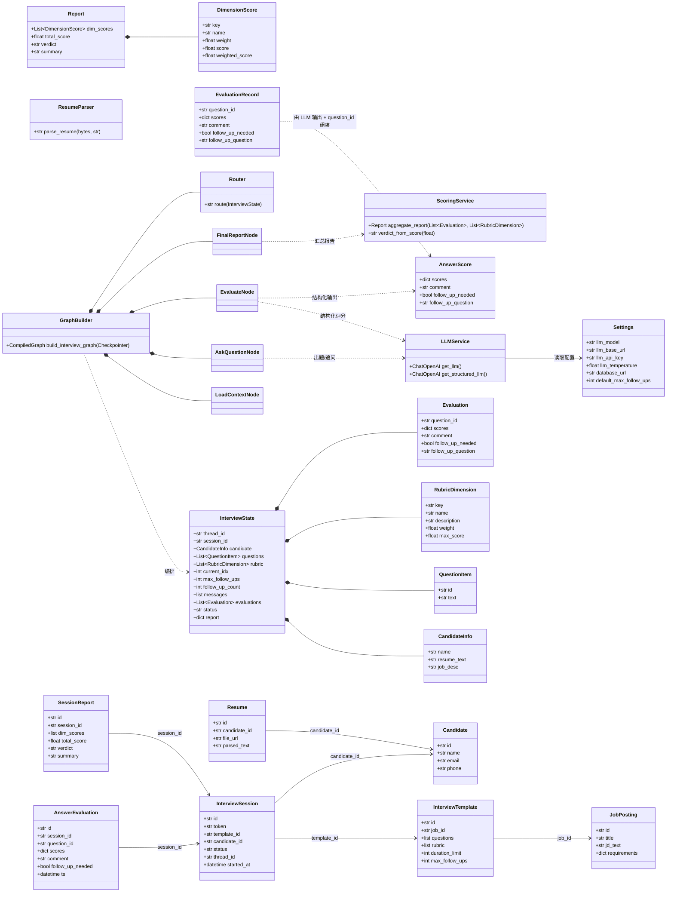
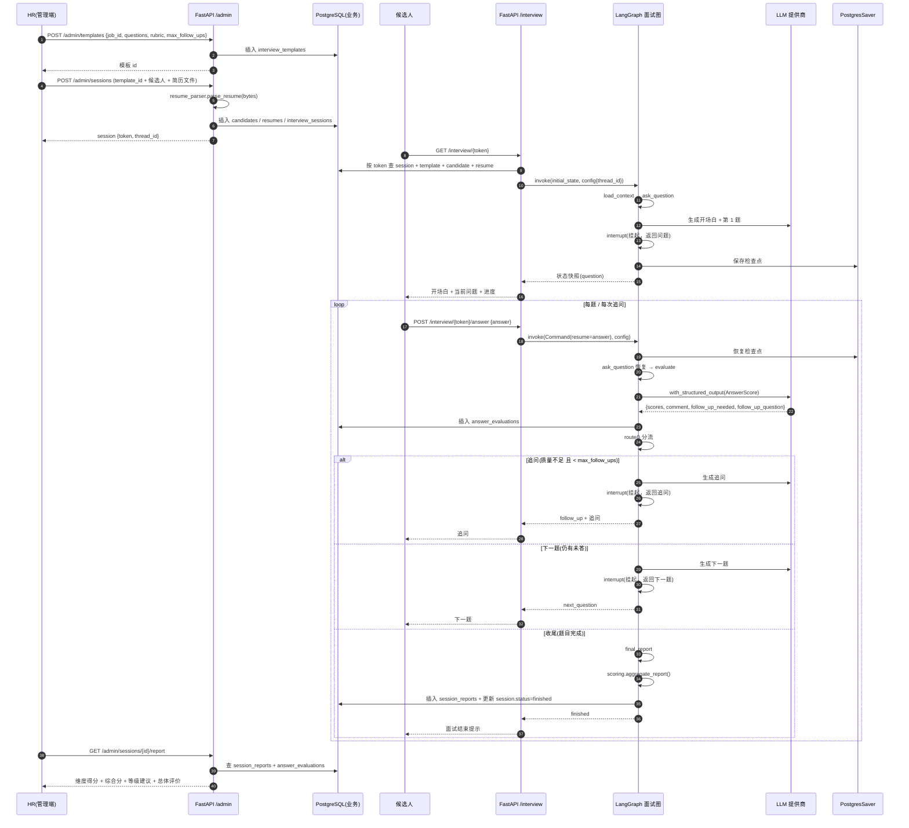
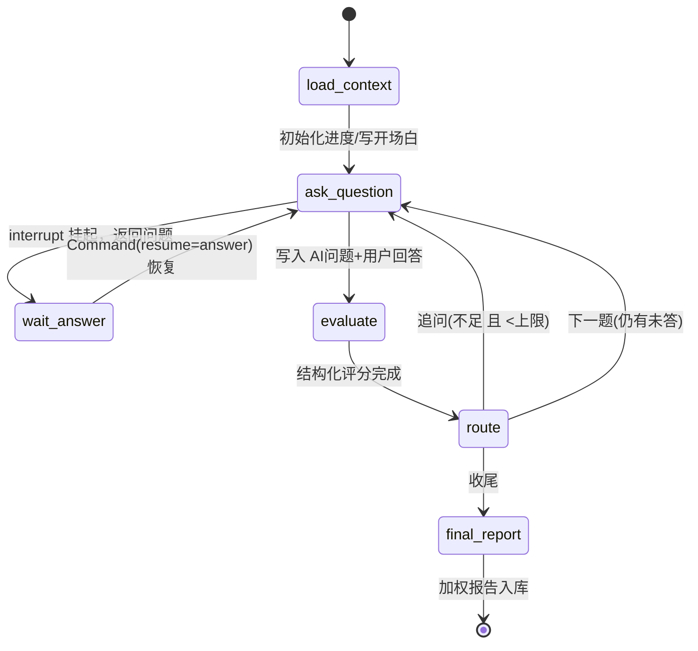
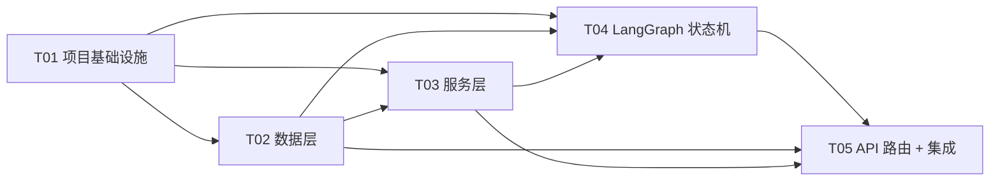

# AI 面试智能体 — 后端核心链路 MVP 架构设计

> 版本：v0.1（MVP）｜ 作者：架构师（高见远）｜ 状态：待评审
> 上游输入：`docs/PRD.md`（许清楚）＋ 根目录 `README.md`（产品完整构想）
> 本文档只覆盖 **后端核心链路 MVP**，不接前端，不做 SSE 流式 / Redis / 向量化。

---

## 1. 实现方案与框架选型

### 1.1 核心技术难点

| 难点 | 说明 | 应对方案 |
| --- | --- | --- |
| 多轮有状态对话（出题 → 答题 → 评分 → 追问/下一题 → 收尾） | 状态在多次请求间需要持久化，且支持中断恢复 | LangGraph `StateGraph` + `interrupt` + PostgreSQL Checkpointer（`PostgresSaver`），按 `thread_id` 断点恢复 |
| 结构化评分可靠可解释 | 逐维度打分 + 理由 + 原话佐证，需强约束 LLM 输出 | Pydantic schema + `with_structured_output`，评分用低温（0.2） |
| 多模型可切换 | 只改 `.env` 不改代码 | `langchain-openai`（OpenAI 兼容协议），统一走 `ChatOpenAI(model/base_url/api_key)`，封装为配置单例 |
| 简历解析多格式 | PDF / DOCX / 纯文本 | `pdfplumber` / `python-docx` / 文本直读，解析失败降级不阻塞建会话 |
| 评分汇总与等级建议 | 维度加权 → 百分制 → 等级 | 纯函数 `scoring.py`，与 LLM 解耦、可单测 |
| 数据模型 7 张表 + 迁移 | 表结构可演进、可复现 | SQLAlchemy 2.x + Alembic，统一 `id/created_at/updated_at` 审计字段 |

### 1.2 框架选型

| 层 | 选型 | 理由 |
| --- | --- | --- |
| 编排 | **LangGraph** | 状态机、条件边 `route`、`interrupt` 人机协同、Checkpointer 断点恢复，天然匹配面试流程 |
| LLM 接入 | **langchain-openai**（OpenAI 兼容协议） | 一套接口切换 DeepSeek / Qwen / GPT / GLM / Claude，仅改 `base_url` |
| 结构化输出 | **Pydantic v2 + `with_structured_output`** | 评分 / 报告 schema 强校验 |
| 后端 | **FastAPI + uvicorn** | 自动 Swagger、异步、表单上传支持好 |
| ORM | **SQLAlchemy 2.x**（`psycopg` v3 驱动） | 成熟、与 Alembic 无缝 |
| 迁移 | **Alembic** | 建表/演进可复现 |
| 配置 | **pydantic-settings** | `.env` 加载 + 类型校验，配合 `@lru_cache` 单例 |
| 简历解析 | **pdfplumber / python-docx** | 满足 PDF/DOCX/纯文本，MVP 不做向量化 |

### 1.3 架构分层（MVP）

```
FastAPI(api/admin + api/interview)
        │ 调用
        ▼
LangGraph 面试图(graph/builder + nodes + route)
        │ 复用
        ├── services/llm.py        （LLM 配置单例）
        ├── services/scoring.py    （评分汇总，纯函数）
        ├── services/resume_parser.py（简历解析）
        └── db/models + db/session  （SQLAlchemy + PostgresSaver 复用同一 DATABASE_URL）
```

关键决策：

1. **同一套 PostgreSQL** 同时承担业务数据（7 张表）与 LangGraph 检查点（`PostgresSaver` 自建 `checkpoints` 等表），通过 `DATABASE_URL` 复用，避免两套库。
2. **会话创建与图首次执行解耦**：`POST /admin/sessions` 只落库并返回 token；`GET /interview/{token}` 首次调用时才从 DB 组装初始 state 并跑图（跑到第一个 `interrupt` 暂停）。这样建会话是纯同步快速操作。
3. **`interrupt` + `Command(resume=...)` 模式**：`ask_question` 节点内部生成问题后调用 `interrupt` 挂起并把问题返回给候选人；候选人提交回答后 `graph.invoke(Command(resume=answer), config)` 恢复，节点把「AI 问题 + 用户回答」写入 `messages`，随后流向 `evaluate`。

---

## 2. 目录结构与文件列表

```
interview-agent/
├── docs/
│   └── ARCHITECTURE.md            # 本文档
├── docker-compose.yml             # postgres + api 本地一键起
├── .env.example                   # 环境变量样例（LLM 多提供商 + DB）
└── backend/
    ├── requirements.txt           # 依赖声明
    ├── alembic.ini                # Alembic 配置（指向 app/db 元数据）
    ├── alembic/
    │   ├── env.py                 # Alembic 环境（读 settings.database_url + Base.metadata）
    │   ├── script.py.mako         # 迁移脚本模板（Alembic 生成）
    │   └── versions/
    │       └── 0001_initial.py    # 7 张表 + checkpointer 兼容（首版迁移）
    └── app/
        ├── __init__.py
        ├── main.py                # FastAPI 入口：创建 app、挂载 admin/interview 路由、启动建表/健康检查
        ├── config.py              # Settings（pydantic-settings）+ get_settings() 单例
        ├── exceptions.py          # 统一业务异常（BizError + 全局异常处理器）
        ├── graph/
        │   ├── __init__.py
        │   ├── state.py           # InterviewState 及子结构 TypedDict + Reducer
        │   ├── builder.py         # build_interview_graph(checkpointer) -> 编译后的图
        │   ├── route.py           # 条件边 route()：追问/下一题/收尾分流
        │   └── nodes/
        │       ├── __init__.py
        │       ├── load_context.py    # 加载 JD/简历/问题集/维度，初始化进度，写开场白
        │       ├── ask_question.py    # 出题或追问（interrupt 挂起等待回答）
        │       ├── evaluate.py        # 结构化评分（AnswerScore）
        │       └── final_report.py    # 汇总加权报告，落库 session_reports
        ├── models/
        │   ├── __init__.py
        │   └── schemas.py         # Pydantic：RubricDimension/Question/AnswerScore/Evaluation/DimensionScore/Report
        ├── services/
        │   ├── __init__.py
        │   ├── llm.py             # get_llm()/get_structured_llm() 单例封装
        │   ├── resume_parser.py   # parse_resume()：PDF/DOCX/文本
        │   └── scoring.py         # aggregate_report()：维度加权→百分制→等级建议
        ├── api/
        │   ├── __init__.py
        │   ├── deps.py            # get_db 依赖
        │   ├── schemas.py         # 请求/响应 Pydantic（TemplateCreate/SessionOut/InterviewContext 等）
        │   ├── admin.py           # 管理端路由：模板/会话/报告/列表
        │   └── interview.py       # 候选人端路由：上下文/答题
        └── db/
            ├── __init__.py
            ├── base.py            # Base + TimestampMixin(id/created_at/updated_at)
            ├── session.py         # engine / SessionLocal / get_db
            └── models/
                ├── __init__.py    # 汇总导出 7 个 model，供 Alembic autogenerate
                ├── job.py         # JobPosting
                ├── template.py    # InterviewTemplate
                ├── candidate.py   # Candidate
                ├── resume.py      # Resume
                ├── session.py     # InterviewSession
                ├── evaluation.py  # AnswerEvaluation
                └── report.py      # SessionReport
```

---

## 3. 数据结构与接口

### 3.1 核心 TypedDict / Pydantic 定义

```python
# ── app/graph/state.py ─────────────────────────────────────
class CandidateInfo(TypedDict):
    name: str
    resume_text: str
    job_desc: str            # JD 文本，供出题/评分上下文

class QuestionItem(TypedDict):
    id: str                  # 问题唯一 id（如 "q1"）
    text: str                # 问题内容

class RubricDimension(TypedDict):
    key: str                 # 维度 key，如 "tech_depth"
    name: str                # 中文名，如 "技术深度"
    description: str         # 评分标准说明
    weight: float            # 汇总权重，如 0.40
    max_score: float         # 维度满分，如 10

class Evaluation(TypedDict):
    question_id: str
    scores: dict             # {"tech_depth": 8, ...}
    comment: str             # 评分理由，含原话佐证
    follow_up_needed: bool
    follow_up_question: str  # 追问问题，空串表示无

class InterviewState(TypedDict, total=False):
    thread_id: str
    session_id: str
    candidate: CandidateInfo
    questions: list[QuestionItem]
    rubric: list[RubricDimension]
    current_idx: int                 # 当前题目下标
    max_follow_ups: int              # 每题追问上限（模板级）
    follow_up_count: int             # 当前题已追问次数
    messages: Annotated[list, add_messages]       # AI 问题 + 用户回答累加
    evaluations: Annotated[list[Evaluation], operator.add]  # 逐题评分累加
    status: str                      # pending/running/finished
    report: dict                     # 最终报告（final_report 写入）

# ── app/models/schemas.py ──────────────────────────────────
class AnswerScore(BaseModel):        # LLM 结构化输出（with_structured_output）
    scores: dict[str, float]         # 维度key -> 得分(0~max_score)
    comment: str                     # 评分理由 + 原话佐证
    follow_up_needed: bool
    follow_up_question: str = ""

class EvaluationRecord(BaseModel):   # 持久化到 answer_evaluations
    question_id: str
    scores: dict[str, float]
    comment: str
    follow_up_needed: bool
    follow_up_question: str = ""

class DimensionScore(BaseModel):
    key: str
    name: str
    weight: float
    score: float                      # 该维度各题均分
    weighted_score: float             # score * weight

class Report(BaseModel):
    dim_scores: list[DimensionScore]
    total_score: float                # 百分制（0~100）
    verdict: str                      # 强烈推荐/推荐/待定/不推荐
    summary: str                      # 总体评价 + 录用风险提示
```

### 3.2 类图



---

## 4. 程序调用流程

### 4.1 时序图（建会话 → 出题 → 答题 → 评分 → 追问/下一题 → 报告）



### 4.2 状态机流转（对应 LangGraph 图）



---

## 5. 任务列表（有序，供工程师逐项实现）

> 共 5 个任务，按依赖顺序。每个任务都给出**源文件清单 + 验收标准**，可直接交给工程师。

### T01 项目基础设施（配置 + 入口 + DB 连接 + Alembic 框架）【P0】

**源文件**：`backend/requirements.txt`、`backend/.env.example`（或根目录）、`docker-compose.yml`、`backend/app/config.py`、`backend/app/main.py`、`backend/app/db/base.py`、`backend/app/db/session.py`、`backend/app/db/__init__.py`、`backend/app/__init__.py`、`backend/alembic.ini`、`backend/alembic/env.py`、`backend/alembic/script.py.mako`

**依赖**：无

**内容**：
- `requirements.txt`（见第 6 节完整内容）
- `.env.example`：`LLM_MODEL / LLM_BASE_URL / LLM_API_KEY / LLM_TEMPERATURE / DATABASE_URL` 等（见第 7 节）
- `docker-compose.yml`：`postgres:16` + `api`（Dockerfile 或直接 uvicorn 挂载）
- `config.py`：`Settings(BaseSettings)`，`@lru_cache get_settings()`
- `db/base.py`：`Base` + `TimestampMixin(id=UUID, created_at, updated_at)`
- `db/session.py`：`engine / SessionLocal / get_db`
- `main.py`：创建 FastAPI app，`/health`，挂载 admin/interview 路由（先占位再于 T05 补全），lifespan 里可选 `Base.metadata.create_all`（MVP 兜底）或引导执行 alembic
- Alembic 三件套，`env.py` 绑定 `settings.database_url` 与 `Base.metadata`

**验收**：`uvicorn app.main:app` 可启动，`/health` 返回 200；`alembic upgrade head` 可执行（即使暂无表）。

---

### T02 数据层（SQLAlchemy 7 张表 + Pydantic schemas + 迁移脚本）【P0】

**源文件**：`backend/app/db/models/__init__.py`、`job.py`、`template.py`、`candidate.py`、`resume.py`、`session.py`、`evaluation.py`、`report.py`、`backend/app/models/__init__.py`、`backend/app/models/schemas.py`、`backend/alembic/versions/0001_initial.py`

**依赖**：T01

**内容**：
- 7 张表对应 model（字段见 3.2 类图 + 第 7 节约定）：
  - `JobPosting`、`InterviewTemplate`（`questions`/`rubric` 用 `JSONB`）、`Candidate`、`Resume`、`InterviewSession`（含 `token` 唯一、`thread_id` 唯一）、`AnswerEvaluation`（`scores JSONB`）、`SessionReport`（`dim_scores JSONB`）
- `models/schemas.py`：`RubricDimension / Question / AnswerScore / EvaluationRecord / DimensionScore / Report` Pydantic 定义（3.1）
- `alembic/versions/0001_initial.py`：7 张表建表迁移

**验收**：`alembic upgrade head` 后在 PostgreSQL 中可见 7 张表；Pydantic schema 可被 `import` 且 `model_dump()` 正常。

---

### T03 服务层（LLM 单例 + 简历解析 + 评分汇总 + 图状态定义）【P0】

**源文件**：`backend/app/services/__init__.py`、`llm.py`、`resume_parser.py`、`scoring.py`、`backend/app/graph/__init__.py`、`backend/app/graph/state.py`、`backend/app/exceptions.py`

**依赖**：T01、T02（scoring 依赖 `models/schemas.py` 的 `EvaluationRecord/Report`）

**内容**：
- `llm.py`：`get_llm()`（温度 `settings.llm_temperature`）、`get_structured_llm()`（`get_llm().with_structured_output(AnswerScore)`，按需），均走配置单例
- `resume_parser.py`：`parse_resume(content: bytes, filename: str) -> str`，按扩展名分发 PDF/DOCX/文本；解析失败返回空串或原文、抛非致命警告（不阻塞建会话）
- `scoring.py`：`aggregate_report(evaluations, rubric) -> Report`，纯函数，含 `verdict_from_score()`（阈值见第 7 节）
- `graph/state.py`：`InterviewState` 及子结构 + `add_messages`/`operator.add` reducer
- `exceptions.py`：`BizError(code, message)` + FastAPI 全局异常处理器（统一 `{code, message, data}` 响应，见第 7 节）

**验收**：`parse_resume` 对三种格式样例返回非空文本；`aggregate_report` 用固定样例产出确定性 `Report`；`get_llm()` 可读取 `.env` 切换模型。

---

### T04 LangGraph 面试状态机（builder + nodes + route）【P0】

**源文件**：`backend/app/graph/builder.py`、`backend/app/graph/route.py`、`backend/app/graph/nodes/__init__.py`、`load_context.py`、`ask_question.py`、`evaluate.py`、`final_report.py`

**依赖**：T01（config/checkpointer）、T02（schemas）、T03（llm/scoring/state）

**内容**：
- `builder.py`：`build_interview_graph(checkpointer)` → `StateGraph(InterviewState)`，边：`START→load_context→ask_question→evaluate`，`evaluate→route` 条件边映射 `{"ask_question","final_report"}`，`final_report→END`；`.compile(checkpointer=PostgresSaver(conn))`（手动创建 `psycopg.connect(dsn, autocommit=True, row_factory=dict_row)` 长连接并 `setup()`）
- `load_context.py`：初始化 `current_idx=0 / follow_up_count=0 / status=running`，写开场白 message
- `ask_question.py`：区分「首问/追问/下一题」生成问题；`question = interrupt({"status":"waiting_answer","question":...})` 挂起；恢复后把 `AIMessage(question) + HumanMessage(answer)` 写入 messages，并推进 `current_idx`/`follow_up_count`
- `evaluate.py`：取当前问题 + 最近一条用户回答，构造 Prompt，`get_structured_llm()` 产出 `AnswerScore`，组装 `EvaluationRecord(question_id=...)` 追加到 `evaluations`
- `final_report.py`：`aggregate_report()` 生成 `Report`，写入 `state["report"]`，并（由 API 层或节点内通过 DB）落库 `session_reports`、更新 `session.status=finished`
- `route.py`：`route(state) -> str`：`follow_up_needed and follow_up_count < max_follow_ups → ask_question`；`current_idx+1 < len(questions) → ask_question`；否则 `final_report`

**验收**：不依赖前端，直接 `build_interview_graph()` 后按 README「MVP 验证」方式跑完一次完整面试（含追问），`route` 分流正确；同一 `thread_id` 中断后可 `Command(resume=...)` 恢复。

---

### T05 API 路由 + 集成联调（admin/interview + 请求响应 schema + 挂载）【P0】

**源文件**：`backend/app/api/__init__.py`、`deps.py`、`schemas.py`、`admin.py`、`interview.py`、`backend/app/main.py`（修改挂载）、`backend/app/db/models/__init__.py`（如需微调）

**依赖**：T01–T04

**内容**：
- `deps.py`：`get_db` 依赖
- `schemas.py`：请求/响应模型（`TemplateCreate/TemplateOut/SessionCreate/SessionOut/InterviewContext/AnswerSubmit/AnswerResponse/ReportOut`）
- `admin.py`（`/admin`）：
  - `POST /admin/templates` 创建模板
  - `POST /admin/sessions`（`multipart/form-data`，含简历文件）→ 解析简历 → 建 candidate/resume/session → 返回 `{token, thread_id}`
  - `GET /admin/sessions/{id}/report` 返回报告
  - `GET /admin/sessions?job_id=&status=` 列表
- `interview.py`（`/interview`）：
  - `GET /interview/{token}`：查 session → 组装 initial_state → 首次 `graph.invoke`（跑到 interrupt）→ 读 `graph.get_state(config).values` 返回 `{opening, question, progress, status}`
  - `POST /interview/{token}/answer`：`graph.invoke(Command(resume=answer), config)` → 读新状态 → 返回 `{status: follow_up|next_question|finished, question, message}`
- `main.py`：注册两个 router，启用 Swagger

**验收**：Swagger 可验证 6 个 MVP 接口；用 `curl`/Swagger 走通「建模板→建会话→取上下文→逐题回答→拿报告」全链路；`answer_evaluations` 与 `session_reports` 正确落库。

---

## 6. 依赖包列表（requirements.txt 完整内容）

```text
# ── Web 框架 ─────────────────────────────
fastapi~=0.115.0
uvicorn[standard]~=0.30.0
python-multipart~=0.0.9          # 管理端简历文件上传

# ── LLM / 编排 ───────────────────────────
langgraph>=0.5,<1.0              # 状态机 + interrupt + checkpointer（>=0.5 消除与 checkpoint-postgres 2.x 的告警）
langchain~=0.3.0                 # Prompt 模板等生态组件
langchain-core~=0.3.0            # add_messages 等核心抽象
langchain-openai~=0.2.0          # OpenAI 兼容协议（DeepSeek/Qwen/GPT/GLM/Claude）
langgraph-checkpoint-postgres~=2.0.0   # PostgresSaver（2.x 与 langgraph>=0.5 配套）

# ── 数据 / 迁移 ─────────────────────────
sqlalchemy~=2.0.30
psycopg[binary]~=3.2.0           # PostgreSQL 驱动
alembic~=1.13.0

# ── 配置 / 校验 ─────────────────────────
pydantic~=2.8.0
pydantic-settings~=2.4.0         # .env 加载（自带 python-dotenv）

# ── 简历解析 ─────────────────────────────
pdfplumber~=0.11.0
python-docx~=1.1.0
```

> 说明：版本用 `~=`（兼容同大版本）给出下限建议；若本地 `pip` 解析出现冲突，以 `pip install -r requirements.txt` 的最终解析结果为准，不强锁死版本。

---

## 7. 共享知识（跨文件约定，工程师必须遵守）

1. **统一响应格式**：所有接口返回 `{"code": 0, "message": "ok", "data": ...}`；业务错误 `code` 非 0，`BizError` 抛出自定义 `code/message`，由 `exceptions.py` 全局处理器兜底（`data` 恒为 `null`）。HTTP 状态码：成功 200，未找到 404，参数错误 422，业务错误 400。
2. **InterviewState 字段**：以 `app/graph/state.py` 为唯一真相源。`messages` 用 `add_messages` 累加，`evaluations` 用 `operator.add` 累加（**节点返回值必须传 list**，如 `{"evaluations": [record]}`，否则 reducer 报错）。
3. **rubric JSONB 结构**（`interview_templates.rubric`）：
   ```json
   [
     {"key":"tech_depth","name":"技术深度","description":"...","weight":0.40,"max_score":10},
     {"key":"experience","name":"项目经验","description":"...","weight":0.30,"max_score":10},
     {"key":"communication","name":"沟通表达","description":"...","weight":0.15,"max_score":10},
     {"key":"job_fit","name":"岗位匹配","description":"...","weight":0.15,"max_score":10}
   ]
   ```
4. **scores JSONB 结构**（`answer_evaluations.scores`）：`{"tech_depth": 8, "experience": 7, ...}`，维度 key 必须与 rubric 对齐，分值 0~该维度 `max_score`。
5. **评分汇总公式**：维度得分 = 该维度在所有已评分题上的均分；`weighted_score = 维度均分 × weight`；`total_score = Σ weighted_score × 10`（各维度满分 10 时即百分制）。等级阈值：`>=90 强烈推荐`、`>=75 推荐`、`>=60 待定`、`<60 不推荐`。
6. **checkpointer 复用**：`PostgresSaver(conn)`（`conn = psycopg.connect(checkpointer_dsn, autocommit=True, row_factory=dict_row)`）与业务 ORM 共用同一 `DATABASE_URL`（同一库，不同 schema/表，由 PostgresSaver 自建 `checkpoints` 等表，需在 `alembic` 之外由 PostgresSaver 初始化，首次调用前执行其 `setup()`）。注意 `from_conn_string` 返回 contextmanager，不适合作为应用级单例。
7. **thread_id 约定**：每个 `interview_sessions.thread_id` = 唯一 UUID；`config = {"configurable": {"thread_id": thread_id}}`；同一 thread_id 中断后可恢复。
8. **LLM 配置单例**：一律通过 `app/services/llm.py` 的 `get_llm()` / `get_structured_llm()` 获取模型，禁止各节点自行 `ChatOpenAI(...)`。模型/温度/base_url/api_key 全部来自 `config.Settings`。`with_structured_output` 默认走 function-calling；如某提供商不支持，可在 `get_structured_llm()` 里回退 `method="json_schema"` 或 `json_mode`（不改业务代码）。
9. **追问计数语义**：`follow_up_count` 表示**当前题**已追问次数；进入下一题时在 `ask_question` 内重置为 0；`max_follow_ups` 来自模板（默认 2，`settings.default_max_follow_ups` 兜底）。
10. **中断/恢复模式**：`ask_question` 用 `interrupt({...})` 挂起并返回问题；恢复用 `graph.invoke(Command(resume=answer), config)`。读当前状态用 `graph.get_state(config)`（取 `.values` 与 `.next`），具体字段以安装的 langgraph 版本为准，工程师需对着该版本 `StateSnapshot` API 核对一次。
11. **表 ID/审计**：7 张业务表统一 `id`（UUID，主键）、`created_at`、`updated_at`（`TimestampMixin` 提供）。`interview_sessions.token`、`thread_id` 唯一索引。
12. **时间与序列化**：所有时间存 UTC `datetime`；JSONB 字段存 JSON 可序列化的 dict/list（Pydantic `.model_dump(mode="json")`），禁止直接存 Pydantic 对象。

---

## 8. 待明确事项（需产品/主理人确认）

| # | 问题 | 当前默认（已按此设计） |
| --- | --- | --- |
| A1 | 评分维度 `max_score` 是否统一 10 分？百分制 = 加权均分 × 10？ | 默认统一 10，`×10` 得百分制 |
| A2 | `max_follow_ups` 模板级可配置？默认值？ | 默认 2，模板字段可配 |
| A3 | 等级建议阈值 | 90/75/60 分档（强烈推荐/推荐/待定/不推荐） |
| A4 | 会话 token 规则（有效期/一次性） | MVP 用 UUID，无过期（P1 强化） |
| A5 | 简历解析失败/空简历策略 | 降级为空串或保留原文，不阻塞建会话 |
| A6 | 是否 docker-compose + 本地 uvicorn 双轨 | 双轨提供，本地跑通为验收底线 |
| A7 | `main.py` 是否 `create_all` 兜底建表 | 默认「Alembic 为主，create_all 为可选兜底」，二者择一执行 |
| A8 | 评分 Prompt / 出题 Prompt 是否要统一模板措辞 | 按 README 语义实现，可后续调优 |
| A9 | `GET /interview/{token}` 首次跑图是否写库 `status=running` | 默认：首次取上下文时由 load_context 置 running |

---

## 附：任务依赖图


