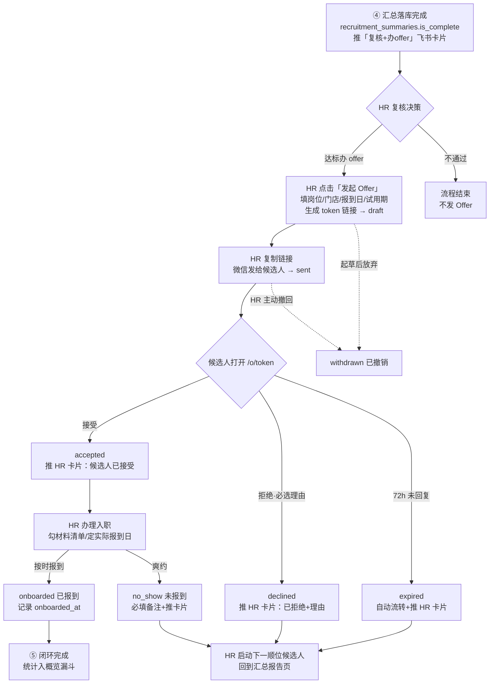

# Interview-Agent 增量 PRD — Offer → 入职闭环

> 版本：v1.0｜ 作者：产品经理（许清楚）｜ 状态：待评审  
> 类型：增量 PRD（在现有四阶段闭环基础上补齐第五阶段）  
> 关联文档：`docs/PRD.md`（核心链路 MVP）、`docs/全流程说明.md`、`docs/飞书HR通知接入说明.md`

---

## 1. 项目信息

| 项            | 内容                                                                        |
| ------------ | ------------------------------------------------------------------------- |
| Language     | 中文                                                                        |
| 技术栈（沿用现状）    | FastAPI + PostgreSQL + Alembic（新增迁移 ≥0010）+ Vue3 / Element Plus 后台        |
| Project Name | `interview-agent`                                                         |
| 增量范围         | 第⑤阶段：Offer 发起 → 候选人确认 → 入职登记 → 报到/未报到，打通 `recruitment_summaries` 之后断掉的数据链 |

### 原始需求复述

"Offer → 入职这一个环节的功能还没有对应功能，给我一个相应的解决方案"——目前汇总落库推飞书卡片之后，发 Offer、候选人回复、入职办理、报到跟进完全在系统外靠人工微信/电话完成，系统无法回答"这个月发了多少 Offer、多少人入职、offer 接受率多少"。

---

## 2. 产品目标

### 三个正交目标

1. **补全数据闭环**：从"复核通过"到"报到/未报到"，全链路状态留痕在系统内，任意时间可回答"发了多少 Offer、接受率多少、入职转化多少、爽约几个"。
2. **候选人零门槛确认**：候选人凭一次性 token 链接自助查看并接受/拒绝 Offer（复用 AI 面试 `/i/{token}` 先例），无需注册登录、不增加任何操作负担。
3. **HR 动作卡片化**：Offer 发起、候选人接受/拒绝、入职跟进等关键节点自动推飞书卡片 + 待办给人力行政部，HR 不需要主动刷系统。

### 可量化成功指标（上线后 1 个月可统计）

- [x] Offer 发送数 / 接受数 / 拒绝数 / 过期数 / 撤销数 全量留痕，后台可按时间段筛选导出
- [x] **Offer 接受率** = accepted / (accepted + declined + expired) 可在汇总页直接看到
- [x] **入职转化率** = onboarded / accepted 可统计；爽约（no_show）单独计数
- [x] 候选人从打开链接到完成接受/拒绝操作 ≤ 1 分钟（确认页单屏完成）
- [x] 状态每次变化均在 1 分钟内推送飞书卡片给 HR（复用现有通知基础设施）

---

## 3. 用户故事

- **US-1（HR）**：作为总部 HR，我想在汇总落库的"复核 + 办 offer"卡片上直接点「发起 Offer」，以便不用切到微信手工整理offer话术，也不用离开系统。
- **US-2（HR）**：作为总部 HR，我想在候选人接受/拒绝/Offer 过期时收到飞书卡片提醒，以便第一时间跟进（拒绝就立刻启动下一顺位候选人）。
- **US-3（候选人）**：作为候选人，我想点开 HR 发我的链接就能看到 Offer 关键信息（岗位、门店、报到日期、试用期），并一键接受或拒绝，以便不用来回打字沟通。
- **US-4（店长）**：作为门店店长，我想知道明天谁要来报到、报到的岗位是什么，以便提前排班和安排带教。
- **US-5（HR）**：作为总部 HR，我想在候选人接受后勾选入职材料清单、标记最终"已报到/未报到"，以便月底向老板汇报招聘转化时心里有数。
- **US-6（HR）**：作为总部 HR，我想看到本月 Offer 接受率、入职率、爽约率的汇总数字，以便判断哪个渠道的候选人质量更好、哪个门店流失严重。

---

## 4. 需求池

### P0（本期必须 — 先打通数据闭环，范围克制）

| 编号   | 需求                       | 场景描述                                                                                                                              | 涉及角色  | 验收要点                                                                                                                                                                 |
| ---- | ------------------------ | --------------------------------------------------------------------------------------------------------------------------------- | ----- | -------------------------------------------------------------------------------------------------------------------------------------------------------------------- |
| P0-1 | Offer 数据模型与状态机           | 新建 `offers` 表（Alembic 0010）：关联 summary_id/candidate_id/job_id/门店、报到日期、试用期天数、备注、状态、token、过期时间、时间戳（sent_at/decided_at/onboarded_at） | 系统    | 状态机含 7 态：`draft→sent→accepted→onboarded / no_show`，及 `declined / expired / withdrawn`；非法流转（如 declined→accepted）被拒绝并报 409                                             |
| P0-2 | Offer 发起（后台）             | 汇总页/报告详情/复核卡片入口点「发起 Offer」→ 弹窗填写岗位、门店、拟报到日期、试用期、备注 → 保存为 draft → 生成 token 链接 → HR 复制链接发微信                                         | HR    | ① 必填校验；② 同一 summary 重复发起时提示已有进行中 Offer；③ 一键复制链接含文案模板；④ 起草即落库，不推候选人任何通知                                                                                               |
| P0-3 | 候选人 Offer 确认页（token 自助页） | 新路由 `/o/{token}`：展示公司名、岗位、门店、报到日期、试用期、备注、截止时间；底部「接受 Offer / 婉拒」按钮                                                                 | 候选人   | ① token 一次性、有效期默认 72h（可配置）；② 过期后页面显示"Offer 已过期，请联系 HR"并自动置 expired、推 HR 卡片；③ 拒绝时必选一个理由（已有更好选择/薪资不符/距离/时间冲突/其他+自由填写）；④ 接受后页面变为确认结果页，token 不可重复操作；⑤ 移动端适配（微信内置浏览器打开正常） |
| P0-4 | 状态变化飞书通知                 | Offer 发送确认、候选人接受、候选人拒绝（含理由）、过期、爽约标记，均推卡片给人力行政部（复用现有 cli/api 双传输 + 幂等机制）                                                           | HR    | ① 卡片含候选人姓名、岗位、门店、当前状态、快捷跳转后台链接；② 通知失败不影响业务主流程（沿用现有约定）                                                                                                                |
| P0-5 | 入职登记                     | Offer 处于 accepted 后，HR 在后台操作「办理入职」：登记实际报到日期（默认取拟报到日）、报到门店（默认取 Offer 门店，可改）、勾选入职材料清单（身份证/健康证/银行卡，纯勾选不做上传）、标记「已报到」或「未报到（爽约）」        | HR、店长 | ① 材料清单勾选项落库（JSON 即可）；② 标记爽约必填备注；③ 状态写 onboarded/no_show 并记录时间戳；④ 爽约标记推 HR 卡片（店长是否收卡片见待确认问题 Q3）                                                                       |
| P0-6 | Offer/入职管理页 + 汇总统计       | 后台新增「Offer/入职」页：列表（按状态/门店/时间筛选）+ 顶部统计卡（发送数、接受率、入职数、爽约数）；概览页追加漏斗数字：汇总完成 → 发 Offer → 接受 → 入职                                        | HR    | ① 筛选与统计口径正确（接受率分母不含 withdrawn/draft）；② 概览页漏斗可按月切换                                                                                                                    |

### P1（下期应做）

| 编号   | 需求           | 说明                                                    |
| ---- | ------------ | ----------------------------------------------------- |
| P1-1 | Offer 内容模板管理 | 按岗位维护默认试用期/薪资区间/欢迎语，发起弹窗自动预填                          |
| P1-2 | 飞书待办（Task）联动 | 发送 Offer 后给 HR 建"3 天未回复需跟进"待办；接受后建"入职材料准备"待办（基础设施已具备） |
| P1-3 | 入职材料在线收集     | 确认页接受后追加一步：候选人拍照上传身份证/健康证（对象存储），HR 后台查看               |
| P1-4 | Offer 过期前提醒  | 截止前 24h 若未回复，推 HR 提醒卡片（可一键延长有效期）                      |
| P1-5 | 拒绝/爽约原因分析    | 按门店/岗位/渠道聚合拒绝理由与爽约率，辅助渠道优化                            |
| P1-6 | 到店直招分支打通     | 无简历现场建档的候选人同样走 Offer 流程（当前仅覆盖有简历链路需确认）                |

### P2（远期）

| 编号   | 需求         | 说明                                  |
| ---- | ---------- | ----------------------------------- |
| P2-1 | 电子合同签署     | 对接第三方电子签（e签宝/法大大），仅在高流失门店验证 ROI 后再上 |
| P2-2 | Offer 审批流  | 多级审批（区域经理审批薪资超标 Offer），当前单 HR 决策够用  |
| P2-3 | 入职后自动转员工档案 | 与排班/薪酬系统打通，报到即建员工档案                 |
| P2-4 | 短信/企微自动触达  | 系统直接发短信给候选人（当前 HR 手动发链接已够用，省成本）     |

---

## 5. 核心流程设计

### 5.1 Offer → 入职 状态流转（含异常分支）



### 5.2 与现有环节的衔接点

1. **入口衔接**：④ 汇总落库推送的「复核 + 办 offer」飞书卡片，追加「发起 Offer」按钮（卡片直达发起弹窗）；后台报告详情页、汇总页同步加入口。
2. **数据衔接**：`offers.summary_id` 外键关联 `recruitment_summaries`，候选人/岗位/门店信息从汇总链路带出自动预填，HR 不重复录入。
3. **通知衔接**：完全复用现有飞书卡片基础设施（按部门解析收件人 + notified_at 幂等 + 失败不阻塞业务）。
4. **先例衔接**：候选人确认页复用 `/i/{token}` 的"token 链接 + 无登录 + 移动端自助"模式，技术心智零新增。

---

## 6. UI 设计说明（文字线框）

### 6.1 后台新增「Offer/入职」页（左侧导航新增菜单，放在"汇总"之后）

```
┌──────────────────────────────────────────────────────┐
│ 本月：Offer 发送 12 ｜ 接受率 75% ｜ 已入职 7 ｜ 爽约 2 │  ← 统计卡片×4
├──────────────────────────────────────────────────────┤
│ 筛选：[状态▼] [门店▼] [日期范围]           [导出]    │
├──────────────────────────────────────────────────────┤
│ 候选人 ｜ 岗位 ｜ 门店 ｜ 状态(彩色标签) ｜ 拟报到日    │
│ ｜ 截止时间 ｜ 操作                                    │
│  · sent 态操作：复制链接 / 撤销 / 延长(可配)          │
│  · accepted 态操作：办理入职                          │
│  · 终态：查看详情                                     │
└──────────────────────────────────────────────────────┘
```

- 状态标签配色建议：sent 蓝 / accepted 绿 / declined 灰 / expired 橙 / onboarded 深绿 / no_show 红 / withdrawn 灰
- 行点击展开详情抽屉：Offer 全字段、拒绝理由、材料清单勾选情况、状态时间线

### 6.2 「发起 Offer」弹窗（从卡片/报告页唤起）

字段：候选人姓名（只读带出）、应聘岗位（默认带出可改）、报到门店（下拉）、拟报到日期（日期选择）、试用期天数（数字，默认带出模板值）、备注（多行文本，如薪资福利说明）、Offer 有效期（默认 72h）。底部按钮：「保存草稿」「生成链接并发送」→ 生成后展示可复制文案块（含链接 + 一句标准话术）。

### 6.3 候选人 Offer 确认页 `/o/{token}`（移动端单屏）

元素清单（自上而下）：

1. 品牌头图 + 公司名「笨二娘隆江猪脚饭」
2. 「恭喜！您的面试已通过」标题
3. Offer 信息卡：岗位、报到门店（含地址）、拟报到日期、试用期、备注说明
4. 有效期提示条：「请在 X月X日 24:00 前确认」
5. 操作区：主按钮「接受 Offer」/ 次按钮「婉拒」
6. 点婉拒 → 底部弹层：单选理由（已有更好选择/薪资不符/距离太远/时间冲突/其他）+ 其他时文本框 →「提交」
7. 提交后结果页：接受→「欢迎加入！HR 将与您联系入职事宜」；拒绝→感谢页；过期→过期提示页（均 token 失效不可再操作）
8. 页脚：联系电话（HR 电话，兜底走线下）

---

## 7. 待确认问题（需 Owner 拍板）

| #  | 问题                              | 产品建议                                                             |
| -- | ------------------------------- | ---------------------------------------------------------------- |
| Q1 | 薪资是否入系统？                        | 建议**不入**，P0 备注字段自由填写（HR 想写就写）。薪资审批是 P2 的事，餐饮小团队 offer 谈薪基本在电话里完成 |
| Q2 | Offer 要不要审批环节？                  | 建议**不要**，单 HR 直接发起。final_score ≥65（推荐档）才允许发起 Offer，用评分档位当隐性门槛    |
| Q3 | 店长是否接收飞书通知？                     | 建议 P0 仅推人力行政部（现状）；店长的"明日报到"提醒放 P1（用飞书待办/群机器人按门店分发）               |
| Q4 | Offer 有效期默认 72h 是否合适？餐饮一线候选人决策快 | 可改 48h，或按门店配置                                                    |
| Q5 | 到店直招（无简历建档）候选人本期是否接入 Offer 流程？  | 建议 P0 先只接"有简历 + 完整三阶段评分"链路，直招分支 P1 补                             |
| Q6 | 爽约后是否允许同一候选人重新发 Offer？          | 建议允许（新建 Offer 记录），保留历史爽约痕迹供 HR 参考                                |
| Q7 | 电子合同/电子签                        | 明确放 P2，本期不做                                                      |

---

## 8. 边界与不做的事（本期明确 OUT）

- ❌ 不做电子合同签署、不做 Offer 审批流
- ❌ 不做候选人材料文件上传（P0 仅勾选确认清单）
- ❌ 不做系统直接短信/微信触达候选人（链接由 HR 手动发，成本最低）
- ❌ 不做薪酬谈判、offer 版本对比等重功能
- ❌ 不改动现有①②③④四阶段任何逻辑，纯增量
