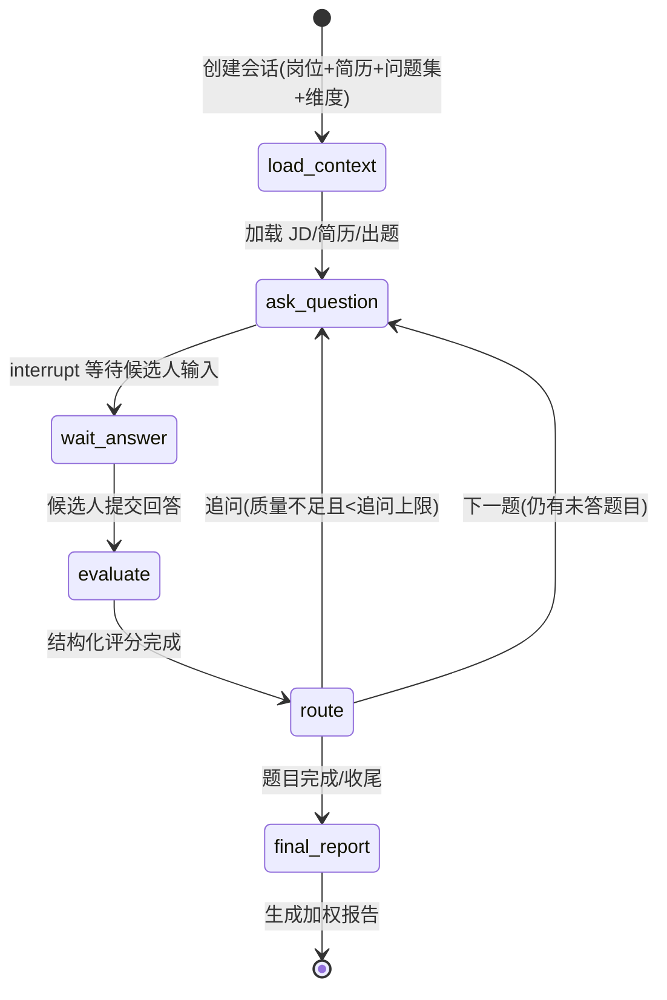
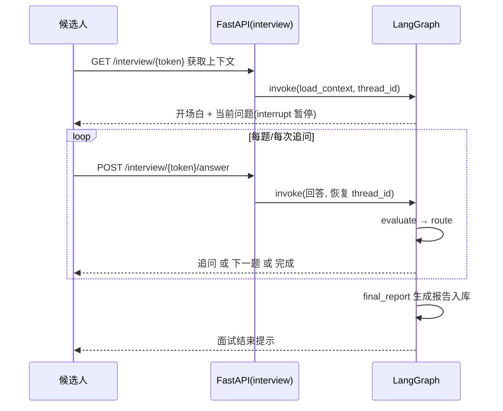
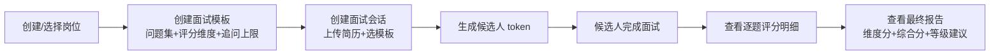

# AI 面试智能体 — 后端核心链路 MVP PRD

> 版本：v0.1（MVP）｜ 作者：产品经理（许清楚）｜ 状态：待评审
> 关联文档：项目根目录 `README.md`（完整产品构想，本 PRD 只覆盖其「后端核心链路」的 MVP 范围）

## 1. 项目信息

| 项 | 内容 |
| --- | --- |
| Language | 中文 |
| 编程语言 | Python 3.11+（FastAPI + LangGraph + LangChain） |
| 数据库 | PostgreSQL（含 LangGraph PostgresSaver checkpointer 复用） |
| LLM 接入 | OpenAI 兼容协议（可切换 DeepSeek / Qwen / GPT / GLM / Claude） |
| Project Name | `interview-agent` |
| MVP 范围 | **仅后端核心链路，不接前端** |

### 原始需求复述

构建一个多轮 AI 面试智能体的**后端核心链路**：候选人通过 token 进入面试，Agent 依据岗位 JD 与候选人简历生成/追问问题，逐题按预设维度结构化评分，最终产出加权汇总的面试报告；HR 通过管理端接口创建模板/会话并查看评分结果。MVP 聚焦「LangGraph 面试状态机 + 结构化评分 + 追问 + 报告 + FastAPI 双端 REST + 简历解析 + PostgreSQL 数据模型」。

---

## 2. 产品目标（MVP 验收标准）

### 三个正交目标

1. **跑通完整面试闭环**：从创建会话到产出报告，后端可脱离前端独立运行，实现「建会话 → 出题 → 答题 → 评分 → 追问/下一题 → 收尾 → 报告」全链路自动化。
2. **评分可靠可解释**：逐题按预设维度打分，输出分数 + 理由 + 候选人原话佐证，最终报告给出加权百分制综合分与录用等级建议。
3. **状态可恢复、模型可切换**：面试会话经 PostgreSQL checkpointer 支持中断恢复；LLM 通过 OpenAI 兼容协议切换多家提供商，仅改配置不改代码。

### 可量化验收标准

- [ ] 通过调用 REST 接口（或直接跑图）即可完成一整套面试，**不依赖任何前端页面**。
- [ ] LangGraph 状态机包含 `load_context → ask_question → (interrupt) → evaluate → route → final_report` 五个核心环节，`route` 能正确分流至「追问 / 下一题 / 收尾」。
- [ ] 每题评分返回结构化结果：`scores`（逐维度 0~max_score）、`comment`（含原话佐证）、`follow_up_needed`、`follow_up_question`。
- [ ] 每题追问次数受可配置上限约束（默认 2，超出自动进入下一题/收尾）。
- [ ] 最终报告包含：维度加权得分、百分制综合分、等级建议（强烈推荐/推荐/待定/不推荐）、总体评价。
- [ ] 切换 LLM 提供商（DeepSeek/Qwen/GPT/GLM/Claude）仅需修改 `.env`（`LLM_MODEL` / `LLM_BASE_URL` / `LLM_API_KEY`），无需改动业务代码。
- [ ] 会话状态写入 PostgreSQL（PostgresSaver），同一 `thread_id` 可中断后恢复继续面试。
- [ ] FastAPI 提供 Swagger 文档，管理端与候选人端接口全部可被验证。
- [ ] 简历解析支持 PDF、DOCX、纯文本三种格式，解析结果以文本形式入库（MVP 不做向量化）。
- [ ] 7 张核心数据表（岗位/模板/候选人/简历/会话/评分/报告）建表并可正常读写。

---

## 3. 目标用户与用户故事

| 角色 | 说明 |
| --- | --- |
| HR 面试官（管理端） | 创建岗位、面试模板、发起会话、查看评分与报告 |
| 候选人（答题端） | 凭 token 进入面试、逐题作答、接收追问 |

### 用户故事

- **US-1（HR）**：作为 HR 面试官，我想要创建「岗位 + 面试模板（预设问题集 + 评分维度）」，以便用统一标准面试同一岗位的不同候选人。
- **US-2（HR）**：作为 HR 面试官，我想要创建面试会话并上传候选人简历（PDF/DOCX/文本），以便生成候选人专属答题入口（token）。
- **US-3（HR）**：作为 HR 面试官，我想要查看某候选人的逐题评分明细与最终报告（维度得分、综合分、等级建议），以便辅助录用决策。
- **US-4（候选人）**：作为候选人，我想要通过 token 获取面试上下文（开场白 + 当前问题），以便开始面试。
- **US-5（候选人）**：作为候选人，我想要逐题提交回答并收到「追问」或「下一题」，以便在合理的引导下完成整场面试。

---

## 4. 需求池（P0 / P1 / P2）

### P0（本次 MVP 必做）

| 编号 | 需求 | 说明 |
| --- | --- | --- |
| P0-1 | LangGraph 面试状态机 | `load_context → ask_question → (interrupt 等待) → evaluate → route → final_report`，含条件边 `route` |
| P0-2 | 逐题结构化评分 | Pydantic + `with_structured_output`，逐维度打分 + 评分理由 + 原话佐证 |
| P0-3 | 追问机制 | 回答质量不足/有延伸价值时自动追问，每题追问上限可配置（默认 2） |
| P0-4 | 最终报告 | 维度得分 = 各题维度均分 × 权重 → 百分制综合分 → 等级建议 + 总体评价 |
| P0-5 | 管理端 REST 接口 | 模板创建、会话创建、报告查询、会话列表 |
| P0-6 | 候选人端 REST 接口 | 获取面试上下文、提交回答并返回下一题/追问 |
| P0-7 | 简历解析 | 支持 PDF / DOCX / 纯文本，解析为文本入库（不做向量化） |
| P0-8 | 数据模型 | 岗位、模板、候选人、简历、会话、评分、报告 7 张表 |
| P0-9 | PostgreSQL checkpointer | PostgresSaver 复用，支持按 `thread_id` 断点恢复 |
| P0-10 | 可切换 LLM 接入 | OpenAI 兼容协议封装，DeepSeek/Qwen/GPT/GLM/Claude 配置切换 |
| P0-11 | 工程底座 | `.env` 配置、`requirements.txt`、Alembic 建表迁移、启动脚本/说明 |

### P1（后续应做）

| 编号 | 需求 | 说明 |
| --- | --- | --- |
| P1-1 | SSE 流式输出 | 提问内容流式返回，提升答题体验 |
| P1-2 | 手动触发/重算评分 | `/admin/sessions/{id}/evaluate` 手动重算 |
| P1-3 | 会话列表筛选与批量导出 | 按 `job_id` / `status` 筛选，导出评分数据 |
| P1-4 | 面试时长/题量上限控制 | 超时自动收尾（route → final_report） |
| P1-5 | 会话 token 鉴权与有效期 | token 生成规则、过期与一次性校验 |
| P1-6 | 可观测（LangSmith） | 节点级耗时、token 统计、链路追踪 |
| P1-7 | 合规声明 | 候选人知情同意、AI 结果仅作参考的免责声明 |

### P2（进阶/后续）

| 编号 | 需求 | 说明 |
| --- | --- | --- |
| P2-1 | 简历-岗位匹配预筛 | 向量化 + 匹配度打分，作为开场/追问素材 |
| P2-2 | 多模态面试 | 语音（ASR/TTS）、视频（表情/微表情分析，合规评估后） |
| P2-3 | 防作弊 | 回答与简历/网络查重、答题时长异常检测 |
| P2-4 | 多语言面试 | 候选人语言自适应（中/英） |
| P2-5 | 批量横向对比 | 同岗位多候选人排行榜与维度对比 |
| P2-6 | Redis 缓存/限流 | 会话级缓存、接口限流 |

---

## 5. 核心用户流程

### 5.1 候选人答题流程（状态机视角）



### 5.2 候选人端接口时序



### 5.3 HR 后台流程



---

## 6. 技术规范（MVP）

### 6.1 数据模型（7 张表）

| 表 | 关键字段 | 说明 |
| --- | --- | --- |
| `job_postings` | id, title, jd_text, requirements | 岗位 |
| `interview_templates` | id, job_id, questions JSONB, rubric JSONB, duration_limit, max_follow_ups | 面试模板 |
| `candidates` | id, name, email, phone | 候选人 |
| `resumes` | id, candidate_id, file_url, parsed_text | 简历（parsed_text 存解析文本） |
| `interview_sessions` | id, token, template_id, candidate_id, status, thread_id, started_at | 面试会话 |
| `answer_evaluations` | id, session_id, question_id, scores JSONB, comment, follow_up_needed, ts | 逐题评分 |
| `session_reports` | id, session_id, dim_scores JSONB, total_score, verdict, summary | 最终报告 |

> 建议：所有表统一加 `id`（UUID/自增）、`created_at`、`updated_at` 审计字段（待确认问题 Q7）。

### 6.2 评分维度结构（`rubric` JSONB）

```json
[
  {"key": "tech_depth",   "name": "技术深度", "description": "...", "weight": 0.40, "max_score": 10},
  {"key": "experience",   "name": "项目经验", "description": "...", "weight": 0.30, "max_score": 10},
  {"key": "communication","name": "沟通表达", "description": "...", "weight": 0.15, "max_score": 10},
  {"key": "job_fit",      "name": "岗位匹配", "description": "...", "weight": 0.15, "max_score": 10}
]
```

### 6.3 API 概要（MVP）

| 方法 | 路径 | 说明 | 端 |
| --- | --- | --- | --- |
| POST | `/admin/templates` | 创建面试模板（问题集 + 评分维度 + 追问上限） | 管理端 |
| POST | `/admin/sessions` | 创建面试会话（上传简历 + 选模板），返回 token | 管理端 |
| GET | `/admin/sessions/{id}/report` | 获取评分报告 | 管理端 |
| GET | `/admin/sessions?job_id=&status=` | 会话列表 | 管理端 |
| GET | `/interview/{token}` | 获取面试上下文（开场白 + 当前问题） | 候选人端 |
| POST | `/interview/{token}/answer` | 提交回答，返回追问/下一题/完成 | 候选人端 |

> 说明：`/admin/sessions/{id}/evaluate`（手动重算）、`/interview/{token}/stream`（SSE 流式）属 P1，MVP 可留接口占位或延后。

### 6.4 状态定义（核心）

参考 README 第 3 节 `InterviewState`：`thread_id`、`candidate`（姓名/简历文本/岗位描述）、`questions`、`rubric`、`current_idx`、`messages`（add_messages 累加）、`evaluations`（add 累加）、`follow_up_count`、`status`、`report`。评分与报告 schema 用 Pydantic 定义并 `with_structured_output` 校验。

---

## 7. 功能边界（MVP 明确不做）

| 不做项 | 说明 | 后续 |
| --- | --- | --- |
| 前端页面 | 候选人面试页 + HR 后台 UI 均不实现 | 后续迭代 |
| 向量化/检索 | 简历 embedding、岗位匹配、追问素材检索 | P2-1 |
| SSE 流式输出 | 提问不流式返回，接口一次返回 | P1-1 |
| Redis 缓存/限流 | 不引入 Redis | P2-6 |
| 多模态 | 语音/视频面试 | P2-2 |
| 防作弊 | 查重、异常检测 | P2-3 |
| 多语言 | 仅中文面试 | P2-4 |
| 批量横向对比 | 多候选人排行榜 | P2-5 |
| 复杂权限体系 | 单管理员即可，无 RBAC/登录体系 | 后续 |

---

## 8. 待确认问题清单

| # | 问题 | 影响 | 建议/默认 |
| --- | --- | --- | --- |
| Q1 | 各评分维度 `max_score` 是否统一（如均 10 分）？百分制换算公式 = 加权均分 × 10？ | 报告计算逻辑 | 默认各维度满分 10，百分制 = 加权均分 × 10 |
| Q2 | 每题追问上限是否作为**模板级**可配置字段（`max_follow_ups`）？默认值？ | 数据模型 + 路由逻辑 | 默认 2，模板级可配置 |
| Q3 | 会话 token 生成规则、有效期、是否一次性？ | 候选人端鉴权 | 建议随机 UUID + 可配置过期时间（P1 强化） |
| Q4 | 面试是否有**时长/题量上限**？超时如何收尾？ | 状态机收尾条件 | MVP 先按「题目做完即收尾」，时长上限列 P1 |
| Q5 | LLM 默认模型与温度（评分低温 0.2 是否全局统一）？ | 评分稳定性 | 默认 `deepseek-chat`，评分温度 0.2 |
| Q6 | 候选人端是否需身份核验（仅 token 还是需姓名/邮箱二次校验）？ | 接口安全 | MVP 仅 token |
| Q7 | 数据库迁移工具确认 Alembic？表是否统一加 `created_at/updated_at`？ | 工程结构 | 默认 Alembic + 审计字段 |
| Q8 | 等级建议阈值如何划分（强烈推荐/推荐/待定/不推荐）？ | 报告 verdict 字段 | 建议 90/75/60 分档（待确认） |
| Q9 | 简历解析失败/上传空简历时的降级策略？ | 简历解析鲁棒性 | 解析失败保留原文或提示 HR，不阻塞建会话 |
| Q10 | MVP 是否需要 docker-compose，还是本地 `uvicorn` 跑通即可？ | 交付形态 | 建议两者都提供，以本地跑通为验收底线 |

---

## 附：MVP 交付物清单（供架构师/研发对齐）

1. `backend/` FastAPI 工程骨架（`main.py`、`graph/`、`models/`、`services/`、`api/`、`db/`）。
2. LangGraph 面试图（`state.py`、`builder.py`、`nodes/*`、`route.py`）+ PostgresSaver checkpointer。
3. 结构化评分与报告 Pydantic schema（`AnswerScore`、`Report`）。
4. 简历解析服务（`resume_parser.py`：pdfplumber / python-docx / 纯文本）。
5. 评分汇总服务（`scoring.py`：维度加权 → 百分制 → 等级建议）。
6. Alembic 迁移脚本（7 张表）+ SQLAlchemy models。
7. `.env.example`（LLM 多提供商配置）+ `requirements.txt` + 启动说明。
8. Swagger 可验证的完整 REST 接口。
