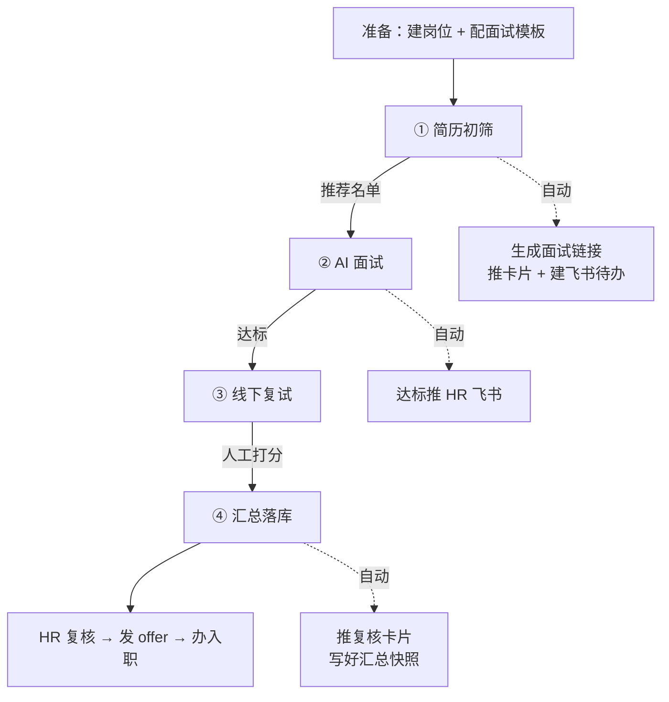

# 招聘全流程说明（当前版本）

> 本文档描述 `interview-agent` 截至 2026-10-13 的完整业务闭环与实现现状。
> 适用范围：AI 驱动的餐饮门店一线招聘（简历初筛 → AI 面试 → 线下复试 → 汇总落库）。

## 1. 一图看懂



**一句话概括**：HR 上传一个岗位文件夹，系统自动初筛排序并把面试链接推到 HR 飞书；候选人自助完成 AI 面试；HR/店长线下复试打分；最后一键汇总落库并提醒 HR 办理 offer 与入职。

## 2. 四个阶段

| 阶段 | 谁来做 | 系统做什么 | 落库 |
| --- | --- | --- | --- |
| ① 简历初筛 | HR 上传岗位文件夹 | 逐份解析简历 → AI 按 JD 多维打分 → 榜单降序；**达到门槛者自动生成 AI 面试链接**；推推荐卡片 + 建 HR 飞书待办 | `resume_screenings` |
| ② AI 面试 | 候选人自助 | 候选人打开链接 → 同意《安全知情协议》→ 多轮问答（含自动追问）→ 逐题评分 → 生成综合报告；**达标自动推 HR 飞书** | `interview_sessions` / `answer_evaluations` / `session_reports` |
| ③ 线下复试 | HR / 店长 | 后台「待 HR 处理」列表驱动 → 约面（时间/地点/面试官/角色）→ 面试后录入分数 + 评语 + 结论；<br>**到店直招**：店长现场面试，一次建档（姓名/手机/来源渠道）并可上传**整场面试录音** | `offline_interviews` |
| ④ 汇总落库 | HR 点一下按钮 | 聚合三阶段分数 → 加权最终分 → 写快照；**自动推「复核 + 办 offer / 入职」卡片** | `recruitment_summaries` |

### 2.1 岗位「免初筛」分支

岗位可标记 `skip_screening = true`。此时流程跳过 AI 打分：**上传简历即直接生成 AI 面试链接**（不做初筛排序），汇总时也不计初筛分（权重自动重新归一化）。

### 2.2 到店直招分支（现场面试）

候选人直接到门店找店长面试，**没有简历、不走初筛、不发 AI 面试链接**。

- 入口：后台「线下复试」页 → **到店直招**（一次建档：岗位 + 姓名 + 手机号 + **来源渠道**）
- 店长可上传**整场面试录音**（一段文件，mp3 / m4a / mp4 / wav 等，≤50MB），支持内联播放与下载
- 建档后直接人工打分（同线下复试打分口径）
- 同一候选人同岗位重复建档会返回 409，避免重复提交；同「姓名 + 手机号」会复用同一候选人档案
- 汇总里以 **来源 = 到店直招** 标识，最终分 = 线下打分（其余环节自动重新归一化）
- 「全链路完成」对到店直招**只要求线下打分完成**（否则他们进不了复核提醒）

> 录音存储：落盘到 `UPLOAD_DIR/audio/YYYY/MM/<uuid>.<ext>`，容器内为 `/app/uploads`。
> 下载接口 `GET /admin/offline-interviews/{id}/audio`（`?download=true` 强制下载）。
> nginx 已放开 `client_max_body_size 100m`，否则上传会被 413 拒绝。
> 音频转文字（ASR）为后续阶段 B，本版本仅存档 + 人工打分。

### 2.3 评分口径

- **初筛分**（百分制）：按 JD 对「技能匹配 / 经验相关 / 稳定性 / 素质与态度」四维打分，权重归一化后重算总分（不直接采用模型给的总分）。
- **AI 面试分**（百分制）：逐题按模板 rubric 打分 → 维度均分 × 权重 → 百分制。
- **线下复试分**（百分制）：HR / 店长人工录入，可带维度明细。
- **最终加权分** = 初筛 × 0.2 + AI 面试 × 0.4 + 线下 × 0.4（**缺环节时对已有环节重新归一化，不惩罚**）。
- **档位**：≥80 强烈推荐 / ≥65 推荐 / ≥50 待定 / <50 不推荐。

## 3. 飞书推送触点（3 张卡片 + 1 个待办）

| # | 触发时机 | 形态 | 内容要点 | 幂等 |
| --- | --- | --- | --- | --- |
| ① | 简历初筛完成 | 蓝色卡片 | 岗位、本次上传统计、推荐名单（分数 + 亮点 + **AI 面试链接**） | 每次上传一次 |
| ② | 简历初筛完成 | 飞书待办（Task） | 标题含岗位与人数；描述含候选人、分数、**面试链接**、截止时间 | 每次上传一次 |
| ③ | AI 面试收尾且综合分 ≥ 阈值 | Markdown 文本 | 候选人、综合分、录用建议、触发口径、会话 id、维度得分、总体评价 | `session_reports.notified_at` |
| ④ | 汇总落库完成 | 橙色卡片 | 「建议发放 offer」与「建议复核后决定」两组，含三段分数；提示办理 offer 与入职 | `recruitment_summaries.notified_at`（逐候选人） |
| ⑤ | 汇总落库完成 | 飞书待办（Task） | 标题含岗位与待复核人数；描述含两组候选人与三段分数、截止时间 | 同 ④（与卡片同批） |

- **收件人**：`FEISHU_HR_OPEN_IDS`（指定人）与 `FEISHU_HR_DEPARTMENT_IDS`（按部门**实时解析在职成员**，新人自动纳入、离职自动过滤）并集去重。
- **传输**：`cli`（复用本机 lark-cli，适合本机联调）或 `api`（飞书 Open API 直连，**服务器部署必须用这个**）。
- **失败策略**：尽力而为 —— 推送/待办异常只记日志，绝不影响业务落库与接口返回。
- **手动补推**：后台初筛页「推送榜单给 HR」、汇总页「推送复核给 HR」。

> ⚠️ 待办需要飞书应用具备 `task:task:write` 权限（见 §8）。
> ⚠️ 卡片里的链接由 `PUBLIC_BASE_URL` 拼出；**服务器上不配置该项会生成 `localhost` 链接，别人打不开**（系统会打 warning 日志并在接口返回 `notify.warning`）。

## 4. 数据模型（10 张业务表）

| 表 | 作用 | 关键字段 |
| --- | --- | --- |
| `job_postings` | 岗位 | `title` / `jd_text` / `requirements` / **`skip_screening`** |
| `interview_templates` | 面试模板 | `questions` / `rubric` / `duration_limit` / `max_follow_ups` |
| `candidates` | 候选人 | `name` / `email` / `phone` / **`source_channel`**(来源渠道) |
| `resumes` | 简历 | `file_url` / `parsed_text` |
| `resume_screenings` | 简历初筛记录 | `total_score`(可空) / `dim_scores` / `recommendation` / `status` / `session_id` / `batch_id` / `folder_name` |
| `interview_sessions` | 面试会话 | `token`(答题入口) / `thread_id`(LangGraph 检查点) / `status` / `consent_agreed_at` |
| `answer_evaluations` | 逐题评分 | `question_id` / `scores` / `comment` / `follow_up_needed` |
| `session_reports` | 面试报告 | `total_score` / `verdict` / `summary` / `notified_at` |
| `offline_interviews` | 线下复试 | `scheduled_at` / `location` / `interviewer` / `interviewer_role`(hr\|store_manager) / `score` / `decision`(pass\|hold\|reject) / **`source`**(online\|walk_in) / **`audio_path`·`audio_name`·`audio_size`**(面试录音) |
| `recruitment_summaries` | 招聘汇总 | 三阶段分数 + `final_score` / `stage` / `is_complete` / `notified_at` / `detail` |

迁移版本：`0007_walk_in_audio`（Alembic，部署时自动升级）。

## 5. 后台页面

| 页面 | 路径 | 用途 |
| --- | --- | --- |
| 概览 | `/console/dashboard` | 总体数据 |
| 岗位管理 | `/console/jobs` | 建岗位、切换**免初筛**开关 |
| 面试模板 | `/console/templates` | 配问题集与评分维度 |
| 简历初筛 | `/console/screening` | 上传文件夹 → AI 打分榜单 → 批量发面试 / 推送榜单给 HR |
| 面试会话 | `/console/sessions` | 会话列表、答题链接、报告入口 |
| 线下复试 | `/console/offline` | **待 HR 处理**列表、约面、打分 |
| 评分报告 | `/console/reports` | AI 面试报告 + 维度雷达图 |
| 数据汇总 | `/console/summary` | 实时汇总 / 落库快照、CSV 导出、推送复核 |

候选人入口：`/i/{token}`（需先同意《安全知情协议》）。

## 6. 接口清单（24 个）

**岗位 / 模板**
```
GET,POST     /admin/jobs
PUT,DELETE   /admin/jobs/{job_id}
GET,POST     /admin/templates
DELETE       /admin/templates/{template_id}
```

**简历初筛**
```
POST         /admin/screenings/upload      # 岗位文件夹批量上传（direct_invite / screen / notify 可选）
GET          /admin/screenings             # 榜单（按分降序）
GET,DELETE   /admin/screenings/{screening_id}
POST         /admin/screenings/invite      # 批量发起 AI 面试
POST         /admin/screenings/notify      # 手动推送榜单给 HR
```

**AI 面试**
```
GET,POST     /admin/sessions
GET          /admin/sessions/{session_id}/report
DELETE       /admin/sessions/{session_id}
GET          /interview/{token}
POST         /interview/{token}/consent
POST         /interview/{token}/answer
```

**线下复试 / 汇总 / 对外**
```
GET,POST     /admin/offline-interviews
POST         /admin/offline-interviews/walk-in        # 到店直招：建档（含候选人）+ 可选录音
POST         /admin/offline-interviews/{id}/audio     # 上传/替换整场面试录音
GET          /admin/offline-interviews/{id}/audio     # 录音播放（?download=true 下载）
PUT,DELETE   /admin/offline-interviews/{offline_id}
POST         /admin/offline-interviews/{offline_id}/score
GET          /admin/summary                # 实时聚合
POST         /admin/summary/rebuild        # 落库（notify 可选）
POST         /admin/summary/notify         # 补推复核卡片
GET          /admin/summary/snapshots      # 已落库快照
GET          /api/scores/candidate/{candidate_id}   # 供外部系统读取
GET          /health
```

## 7. 关键配置

| 变量 | 默认 | 说明 |
| --- | --- | --- |
| `LLM_MODEL` / `LLM_API_KEY` / `LLM_BASE_URL` | deepseek-chat | OpenAI 兼容协议，可换 GPT / Qwen / GLM |
| `DATABASE_URL` | localhost:5432 | 容器内由 compose 覆盖为 `postgres` |
| `PUBLIC_BASE_URL` | `http://localhost:3000` | **卡片/待办里的链接基址，部署必须改** |
| `UPLOAD_DIR` / `MAX_AUDIO_MB` | `uploads` / `50` | 面试录音落盘根目录与单文件上限 |
| `SUMMARY_WEIGHT_SCREENING/AI/OFFLINE` | 0.2 / 0.4 / 0.4 | 三阶段权重 |
| `FEISHU_NOTIFY_ENABLED` | false | 飞书推送总开关 |
| `FEISHU_NOTIFY_THRESHOLD` | 65 | AI 面试达标推送阈值 |
| `FEISHU_SCREENING_NOTIFY_ENABLED` | true | 初筛完成是否推卡片 |
| `FEISHU_SCREENING_MIN_SCORE` | 65 | 初筛「通过」门槛（= 推荐名单门槛） |
| `FEISHU_SCREENING_AUTO_INVITE` | true | 初筛通过是否自动生成面试链接 |
| `FEISHU_SUMMARY_NOTIFY_ENABLED` | true | 汇总完成是否推复核卡片 |
| `FEISHU_TASK_ENABLED` | true | 是否创建飞书待办 |
| `FEISHU_TASK_ASSIGNEE_OPEN_IDS` | 空 | 待办负责人；留空 = 所有收件人各一条 |
| `FEISHU_TASK_IDENTITY` | bot | 待办创建身份（cli 传输时可选 user） |
| `FEISHU_TASK_DUE_DAYS` | 2 | 待办截止天数 |
| `FEISHU_NOTIFY_TRANSPORT` | cli | `cli` / `api` |
| `FEISHU_HR_OPEN_IDS` / `FEISHU_HR_DEPARTMENT_IDS` | 空 | 收件人 / 收件部门 |

## 8. 部署前置（服务器上线四件事）

1. **`PUBLIC_BASE_URL` 改成公网地址**，如 `http://<服务器IP>:3000` 或 `https://hire.xxx.com`。
   否则卡片里是 `localhost` 链接，HR 打不开（系统会告警但链接仍是坏的）。
2. **`FEISHU_NOTIFY_TRANSPORT=api`** + `FEISHU_APP_ID` + `FEISHU_APP_SECRET`。
   默认 `cli` 依赖本机 lark-cli / node / macOS keychain，Linux 容器里全都没有。密钥建议放 `.env.local`（已被 `.gitignore`）。
3. **飞书应用申请 `task:task:write`**（+ `task:task:writeonly`）权限并发布，否则**待办创建失败**（卡片不受影响）。
4. **放行 3000 端口**（前端 nginx 反代 `/admin` `/interview` `/api` `/health` 到 api 容器）；飞书应用**可用范围**需包含 HR 用户（否则报 230013）。

> `.env` 与 `.env.*` 均被 `.gitignore` 忽略，`git pull` **不会**覆盖服务器配置 —— 新增配置项必须手动补，否则走代码默认值。
> 部署时 api 容器会自动执行 `alembic upgrade head`，迁移无需手动跑。

## 9. 本地开发与验证

```bash
# 服务：前端 localhost:3000 / 后端 localhost:8000 / Postgres(docker) localhost:5432
launchctl kickstart -k gui/$(id -u)/com.benerniang.interview-backend   # 改后端代码后重启

cd backend
.venv/bin/python -m pytest tests/ -q                     # 全量单测（177 项）
.venv/bin/python scripts/smoke_recruitment_e2e.py        # 全链路端到端（静默推送，不打扰 HR）
.venv/bin/python scripts/send_feishu_test.py --kind screening --dry-run   # 卡片预览
.venv/bin/python scripts/send_feishu_test.py --kind screening --open-id <ou>  # 真发给自己
```

## 10. 已知限制 / 待办

- **飞书待办权限未开通**：`task:task:write` 尚未申请，待办创建会失败（卡片正常）。
- **面试录音仅存档，尚未转文字**：ASR（阶段 B）未接入 —— 目前录音只落盘并可回放/下载，打分由店长人工录入；接 ASR 需提供云厂商 API Key。
- **初筛为同步逐份调用 LLM**：简历量大时上传接口会较慢，后续可改后台任务或并发。
- **README / 接口文档未同步**：`README.md` §11 与 `docs/接口文档.md` 尚未补入三类推送与新增接口。
- **服务器部署需先补配置**：`PUBLIC_BASE_URL`、`FEISHU_NOTIFY_TRANSPORT=api` 与应用凭据、`task:task:write` 权限（见 §8）。
