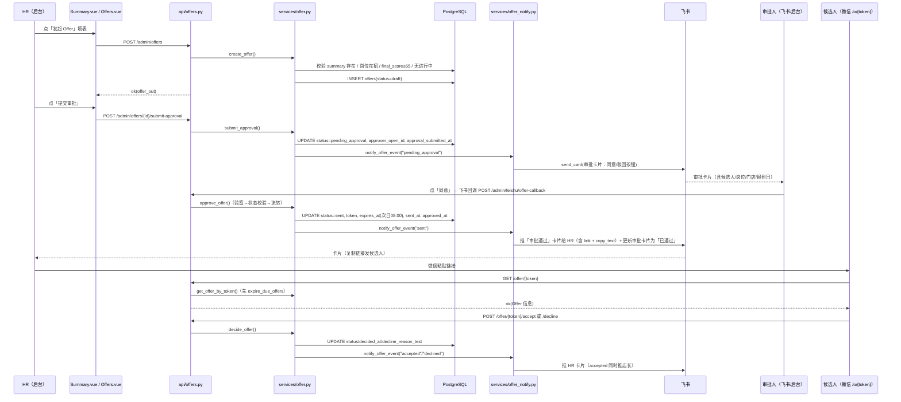
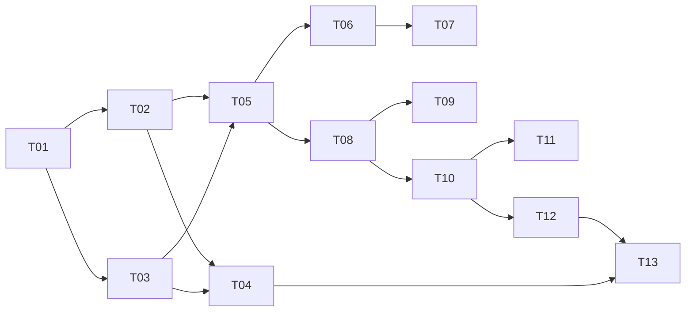

# 设计方案 — Offer → 入职闭环（interview-agent 增量）v2

> 架构师：高见远｜输入：PRD《Offer → 入职闭环》v1.0 + **HR 评审结论（2026-10-15）**
> 原则：纯增量、零新依赖、最大化复用现有先例（token 自助页 / 飞书卡片 / 快照隔离 / 统一响应 / Alembic 迁移链）。
> 状态：待开发排期

## 0. v1 → v2 变更记录（依据 HR 评审结论）

| # | HR 结论 | v1 设计 | v2 变更 | 影响面 |
|---|---|---|---|---|
| 1 | **发 Offer 需要上级审批（飞书卡片审批）** | 无审批流 | 新增 3 个状态（pending_approval / rejected）+ 审批卡片（带按钮）+ **飞书卡片回调接口**（新基建） | ⚠️ 重大：状态机、API、通知、基础设施 |
| 2 | **店长也要收到通知** | 仅推人力行政部 | 通知收件人增加店长（按门店解析 open_id），新增报到提醒卡片 | 通知层、配置、通讯录解析 |
| 3 | **候选人当天 8 点前回复** | 发送后 72h 过期 | 过期时间改为**发送次日的本地 08:00**（可配小时数） | 过期计算逻辑（惰性扫描机制不变） |
| 4 | **婉拒理由自由填写文字** | 5 类枚举 + other 补文字 | 去掉枚举，仅保留自由文本 `decline_reason_text` | 简化：字段、API、前端弹层 |
| 5 | **到店直招（无简历）本期接入** | 本期仅完整链路 | 入口放开至 walk_in 来源；确认 summary 覆盖 | 入口放开 + 汇总覆盖校验 |
| 6 | **入职不需要材料清单功能** | 勾选身份证/健康证/银行卡 | 删除 `checked_materials`，办理入职简化为「已报到 / 未报到」+ 实际报到日 | 简化：字段、API、弹窗 |
| 7 | **放鸽子后可重发，但要确认岗位是否还在招** | 允许重发 | 重发时校验 `job_postings.is_active`（新增字段）+ 停招岗位禁止发起 | 岗位表加列 + 后台开关 + 校验 |
| 8 | 薪资不入库 | 同 | 不变 | — |
| 9 | 电子签不做 | 同 | 不变 | — |

> 净效果：**新增 3 个工作块**（审批流 + 回调基建、店长通知、岗位在招），**简化 2 个工作块**（理由枚举、材料清单），并引入一项**外部前置依赖**（公网 HTTPS 域名，见评估报告 R1）。

---

## 1. 实现方案与框架选型

### 1.1 核心技术挑战与对策

| 挑战 | 对策 | 依据先例 |
|---|---|---|
| Offer 10 态状态机（含审批）+ 非法流转拒绝 | 独立服务层 `services/offer.py` 集中定义常量与流转表，路由层只调不判 | `offline_interviews.status` 已是简单状态列，本功能升级为显式状态机 |
| **飞书卡片审批（卡片按钮 + 回调）** | 卡片新增按钮元素（`build_approval_card`）；后端新增回调端点 `POST /admin/feishu/offer-callback`（验签→流转→更新卡片）；**同时保留后台审批兜底入口**（同一服务层逻辑） | 现有 `build_card` 仅支持文本块，需扩展；回调为新基建（详见 3.4 与评估报告 R1） |
| 过期自动流转，但 main.py lifespan 无调度设施 | **惰性判定**：所有读路径先执行 `expire_due_offers()`；过期时间 = **发送次日本地 08:00** | 系统无 APScheduler/celery；误差几分钟无业务影响 |
| 候选人零门槛确认 | 复用 `interview_sessions.token + /i/{token}` 模式：`offers.token`（uuid4().hex）+ 前端顶层路由 `/o/:token` | `screening.py` L169 `token=uuid.uuid4().hex` |
| 关键节点卡片化（含店长） | 复用 `feishu_notify.send_card / resolve_recipients`，新建 `services/offer_notify.py`；店长收件人按 open_id 解析 | `build_summary_card` / `notify_summary_review` |
| Offer 内容不随岗位/档案变化 | 快照模式：创建时冗余 `candidate_name / job_title / store_name / source` | `company_profile_snapshot` |
| 接受率/入职率/爽约率统计 | 单条 SQL 聚合（`func.count + case`）+ 漏斗四段，按月切换 | `build_summary_rows` 的聚合先例 |
| 到店直招（walk_in）接入 | 复用既有 `recruitment_summaries`（walk_in 也进汇总，`is_complete` 只要求线下打分完成）→ `offers.summary_id` 直接覆盖两种来源 | `offline_interviews.source` + 全流程说明 §2.2 |

### 1.2 架构模式

维持现有 **FastAPI 分层**：`api/`（路由+Pydantic 校验）→ `services/`（业务编排）→ `db/models/`（ORM）。前端维持 Vue3 + Element Plus，新增一个顶层候选人页 + 一个后台管理页。**不引入新框架、新依赖包**。

### 1.3 关键设计决策

1. **门店为自由文本**：系统无门店主数据表（`offline_interviews.location` 即自由文本）。`offers.store_name` 用 String(255)，创建时预填自最近一次线下复试的 `location`，可改。
2. **两条发送路径均需审批**：`draft → pending_approval`（HR 提交）→ 审批人同意后 `→ sent`（此时才生成 token 与 expires_at）。
3. **审批双入口（关键容错设计）**：审批人既可在**飞书卡片上点按钮**（回调），也可**登录后台点审批**；两者调用同一个服务层函数 `approve_offer() / reject_offer()`，行为完全一致。**若 HTTPS 回调暂不具备，后台入口即为可用降级方案**（见评估报告 R1）。
4. **同一 summary 进行中 Offer 唯一**：PostgreSQL 部分唯一索引 `UNIQUE(summary_id) WHERE status IN ('draft','pending_approval','rejected','sent','accepted')`（rejected 可修改重提，故计入进行中），服务层先查先提示（409），索引兜底并发。
5. **过期时间 = 发送次日 08:00**：HR 结论「候选人当天 8 点前回复」。为避免上午发出的 Offer 只有 2 小时窗口，取**次日 08:00**（`offer_confirm_hour=8`，`offer_confirm_tz_offset=8` 可配）。惰性扫描机制不变。
6. **婉拒理由为自由文本**：仅 `decline_reason_text: TEXT`，前端一个文本框。**建议选填**（降低婉拒摩擦，避免候选人因必填而放弃操作），待 HR 最终确认。
7. **岗位在招校验**：`job_postings` 新增 `is_active: Boolean = True`；`is_active=False` 的岗位**禁止发起 Offer**（422），后台岗位管理页加「停招/恢复」开关。
8. **复核卡片入口**：飞书卡片无业务回调时以链接形式落地（`{PUBLIC_BASE_URL}/console/offers?summary_id=...`）；审批卡片则使用真实按钮（见 3.4）。
9. **到店直招入口同源**：Summary 页对 `source=walk_in` 且线下打分完成的候选人也显示「发起 Offer」（`is_complete=true` 判断已覆盖）。

---

## 2. 数据模型

### 2.1 `offers` 表 DDL 级设计（Alembic 0010）

| 字段 | 类型 | 约束/默认 | 说明 |
|---|---|---|---|
| id | UUID | PK, default uuid4 | TimestampMixin |
| summary_id | UUID | NOT NULL, FK→recruitment_summaries.id, index | 溯源汇总记录（覆盖 online / walk_in 两种来源） |
| candidate_id | UUID | NOT NULL, FK→candidates.id, index | |
| job_id | UUID | NOT NULL, FK→job_postings.id, index | |
| candidate_name | VARCHAR(255) | NOT NULL DEFAULT '' | 快照 |
| job_title | VARCHAR(255) | NOT NULL DEFAULT '' | 岗位名快照，默认带出 job.title 可改 |
| store_name | VARCHAR(255) | NOT NULL DEFAULT '' | 报到门店（自由文本） |
| source | VARCHAR(32) | NOT NULL DEFAULT 'online' | 来源快照：online / walk_in（v2 新增，用于列表区分） |
| report_date | DATE | NOT NULL | 拟报到日期 |
| probation_days | INT | NOT NULL DEFAULT 30 | 试用期天数 |
| note | TEXT | NOT NULL DEFAULT '' | 备注（薪资不入库，需要时自由写） |
| status | VARCHAR(32) | NOT NULL DEFAULT 'draft', index | **10 态**见 2.2 |
| token | VARCHAR(64) | NULL, UNIQUE, index | **审批通过时**生成 uuid4().hex |
| expires_at | TIMESTAMPTZ | NULL | 审批通过时 = **发送日期次日的本地 08:00**（UTC 存储） |
| sent_at | TIMESTAMPTZ | NULL | 审批通过（发出）时间 |
| **approver_open_id** | VARCHAR(64) | NOT NULL DEFAULT '' | 审批人 open_id（提交审批时解析落库） |
| **approval_submitted_at** | TIMESTAMPTZ | NULL | 提交审批时间 |
| **approved_at** | TIMESTAMPTZ | NULL | 审批通过时间 |
| **rejected_at** | TIMESTAMPTZ | NULL | 审批驳回时间 |
| **approval_note** | TEXT | NOT NULL DEFAULT '' | 审批意见（驳回时建议必填） |
| **approval_message_id** | VARCHAR(128) | NOT NULL DEFAULT '' | 审批卡片消息 id（用于回调后更新卡片为「已通过/已驳回」） |
| decided_at | TIMESTAMPTZ | NULL | 候选人接受/婉拒时间 |
| expired_at | TIMESTAMPTZ | NULL | 惰性过期流转时间 |
| withdrawn_at | TIMESTAMPTZ | NULL | 撤回时间 |
| withdraw_reason | TEXT | NOT NULL DEFAULT '' | 撤回原因 |
| **decline_reason_text** | TEXT | NOT NULL DEFAULT '' | 候选人婉拒理由（**自由文本**，v2 去掉枚举字段） |
| onboarded_at | TIMESTAMPTZ | NULL | 报到/未报到标记时间 |
| actual_report_date | DATE | NULL | 实际报到日期（默认拟报到日） |
| onboard_store | VARCHAR(255) | NOT NULL DEFAULT '' | 实际报到门店（默认 Offer 门店） |
| no_show_note | TEXT | NOT NULL DEFAULT '' | 未报到说明（标记未报到时必填） |
| created_at / updated_at | TIMESTAMPTZ | NOT NULL | TimestampMixin |

> v2 删除：`decline_reason`（枚举）、`checked_materials`（材料清单）。

**索引**：
- `ix_offers_status(status)`（列表筛选）
- `ix_offers_summary_id` / `ix_offers_candidate_id` / `ix_offers_job_id`（FK 查询）
- `ix_offers_sent_expiry(status, expires_at)`（惰性过期扫描：`WHERE status='sent' AND expires_at < now`）
- `uq_offers_summary_active`：`UNIQUE(summary_id) WHERE status IN ('draft','pending_approval','rejected','sent','accepted')`（部分唯一索引）

### 2.2 状态机（10 态，常量与流转表放 `services/offer.py`）

状态集：`draft / pending_approval / rejected / sent / accepted / declined / expired / withdrawn / onboarded / no_show`

| from | to | 触发方 | 附加动作 |
|---|---|---|---|
| draft | pending_approval | HR「提交审批」 | 落 `approver_open_id`、`approval_submitted_at`；**推审批卡片（带同意/驳回按钮）** |
| rejected | pending_approval | HR 修改后重新提交 | 同上（可更新字段后重提） |
| pending_approval | sent | **审批人同意**（卡片回调 / 后台） | 生成 token、`expires_at`（次日 08:00）、`sent_at`、`approved_at`；**推「审批通过」卡片给 HR（含链接 + 话术）**；更新审批卡片 |
| pending_approval | rejected | **审批人驳回** | `rejected_at`、`approval_note`；推 HR 卡片（含驳回意见）；更新审批卡片 |
| draft / pending_approval / rejected / sent | withdrawn | HR 撤回 | `withdrawn_at`、`withdraw_reason` |
| sent | accepted | 候选人接受 | `decided_at`；推卡片（HR + **店长**） |
| sent | declined | 候选人婉拒 | `decided_at`、`decline_reason_text`；推卡片（HR） |
| sent | expired | 系统（惰性判定） | `expired_at`；推卡片 |
| accepted | onboarded | HR 标记已报到 | `onboarded_at`、`actual_report_date`、`onboard_store` |
| accepted | no_show | HR 标记未报到（必填说明） | `onboarded_at`、`no_show_note`；推卡片 |

终态：`declined / expired / withdrawn / onboarded / no_show`（`rejected` 非终态，可重提）。非法流转一律 `BizError(409, "Offer 当前状态为 {status}，不允许变更为 {to}")`。

### 2.3 Alembic 迁移

- 文件：`backend/alembic/versions/0010_offer_onboarding.py`，`revision="0010_offer_onboarding"`，`down_revision="0009_company_profile"`
- upgrade：
  1. `op.create_table("offers", ...)` + 全部索引/部分唯一索引
  2. **`op.add_column("job_postings", sa.Column("is_active", sa.Boolean(), nullable=False, server_default=sa.true()))`**（岗位在招开关，v2 新增）
- downgrade：drop 索引 → drop 表 → `op.drop_column("job_postings", "is_active")`

### 2.4 概览漏斗聚合方案

不改现有表。漏斗四段实时聚合（v2 增加「审批中」计数）：
- 汇总完成数：`recruitment_summaries WHERE is_complete = true [AND date_trunc('month', snapshot_at) = :month]`
- 发 Offer 数：`offers WHERE sent_at IS NOT NULL [AND date_trunc('month', sent_at) = :month]`
- 接受数：`offers WHERE status IN ('accepted','onboarded','no_show')`
- 入职数：`offers WHERE status = 'onboarded'`
- 附加：`pending_approval` 数量（审批积压提醒）

---

## 3. 接口设计

统一响应 `{"code":0,"message":"ok","data":...}`；错误走 `BizError`。新增文件 `backend/app/api/offers.py`，含两个 router（`/admin`、`/offer`）+ 回调端点。

### 3.1 管理端（/admin）

| # | 方法/路径 | 请求 | 响应 data | 错误 |
|---|---|---|---|---|
| 1 | `GET /admin/offers` | Query: `status? job_id? store? keyword? source? date_from? date_to?` | `[offer_out]`（先惰性过期扫描） | — |
| 2 | `GET /admin/offers/{offer_id}` | — | `offer_out`（含状态时间线） | 404 |
| 3 | `GET /admin/offers/stats` | Query: `month? job_id?` | `{draft, pending_approval, sent, accepted, declined, expired, onboarded, no_show, withdrawn, accept_rate, onboarding_rate, no_show_rate, funnel:{...}}` | — |
| 4 | `POST /admin/offers` | `OfferCreate{summary_id*, job_title?, store_name*, report_date*, probation_days?=30, note?=""}` | `offer_out`（draft） | 404 汇总不存在；**422 岗位已停招 is_active=False**；422 必填缺失；409 该 summary 已有进行中 Offer |
| 5 | `PATCH /admin/offers/{offer_id}` | `OfferUpdate{job_title? store_name? report_date? probation_days? note?}` | `offer_out` | 404；409 仅 draft/rejected 可改 |
| 6 | `POST /admin/offers/{offer_id}/submit-approval` | `OfferSubmit{}` | `offer_out`（pending_approval）+ `approval_notify` 结果 | 404；409 仅 draft/rejected；422 无审批人可解析 |
| 7 | `POST /admin/offers/{offer_id}/approve` | `OfferApprove{note?=""}` | `{offer, link, copy_text}`（已生成链接） | 404；409 非 pending_approval |
| 8 | `POST /admin/offers/{offer_id}/reject` | `OfferReject{note*=""}` | `offer_out`（rejected） | 404；409 非 pending_approval；422 驳回意见必填 |
| 9 | `POST /admin/offers/{offer_id}/withdraw` | `OfferWithdraw{reason?=""}` | `offer_out` | 404；409 非 draft/pending_approval/rejected/sent |
| 10 | `POST /admin/offers/{offer_id}/onboard` | `OfferOnboard{result*:"onboarded"|"no_show", actual_report_date?, onboard_store?, note?（no_show 必填）}` | `offer_out`；no_show 推卡片 | 404；409 非 accepted；422 未报到缺说明 |

> 说明：`approve / reject`（#7/#8）是**后台兜底入口**，与飞书卡片按钮走同一服务层函数。

### 3.2 候选人端（/offer，无需鉴权，token 即凭证）

| # | 方法/路径 | 请求 | 响应 data | 错误 |
|---|---|---|---|---|
| 1 | `GET /offer/{token}` | — | `{status, candidate_name, job_title, store_name, report_date, probation_days, note, expires_at, company_name, hr_contact_phone, decline_reason_text}`（进入即惰性过期） | 404 |
| 2 | `POST /offer/{token}/accept` | — | `{status:"accepted", decided_at}`（幂等） | 404；409 非 sent |
| 3 | `POST /offer/{token}/decline` | `OfferDecline{reason_text?=""}`（**自由文本，v2 建议选填**） | `{status:"declined", decided_at}` | 404；409 非 sent |

### 3.3 复用文案模板（审批通过后返回的 `copy_text`）

```
【{公司名}】{candidate_name} 您好，恭喜您通过我们的面试！
岗位：{job_title}
报到门店：{store_name}
拟报到日期：{report_date}
试用期：{probation_days} 天
备注：{note 或"无"}
请在 {expires_at 本地时间（如 10月17日 08:00）} 前点击链接确认是否接受 Offer：
{link}
```

### 3.4 飞书卡片回调接口（v2 新增基建，★技术风险项）

| 方法/路径 | 请求 | 说明 |
|---|---|---|
| `POST /admin/feishu/offer-callback` | 飞书卡片交互事件（JSON） | ① 验签（`verification_token` / 签名头）② 解析 `action.value` 中的 `{offer_id, action:"approve"|"reject"}` ③ 调用 `approve_offer()/reject_offer()` ④ 更新原卡片（`im.v1.message.patch`，用 `approval_message_id`）⑤ 返回 toast |
| `GET/POST /admin/feishu/offer-callback` | 飞书 URL 校验请求（`challenge`） | 首次配置回调地址时飞书会发校验请求，需原样回显 `challenge` |

**前置条件（外部配置，见评估报告 R1）**：飞书开放平台需配置「卡片请求网址」，且该地址必须为**公网 HTTPS**；当前 `PUBLIC_BASE_URL` 默认 `http://localhost:3000`，服务器若要上线此能力必须准备域名 + 证书。
**降级方案**：回调不可用时，审批仅在后台完成（#7/#8），审批卡片退化为「通知 + 后台链接」，业务闭环不受影响。

---

## 4. 文件列表及相对路径

### 后端新增

| 文件 | 职责 |
|---|---|
| `backend/app/db/models/offer.py` | `Offer` ORM 模型（含审批字段、10 态 status） |
| `backend/alembic/versions/0010_offer_onboarding.py` | 迁移：建 offers 表 + 索引 + `job_postings.is_active` |
| `backend/app/services/offer.py` | 状态机常量与流转校验、创建/编辑/提交审批/审批/撤回/入职/候选人决策编排、`expire_due_offers()`、统计聚合、`build_copy_text()`、岗位在招校验 |
| `backend/app/services/offer_notify.py` | 卡片构造：审批卡片（**带按钮**）/ 审批通过 / 已驳回 / 已接受（含店长）/ 已婉拒 / 已过期 / 未报到 + `notify_offer_event()` 编排 |
| `backend/app/api/offers.py` | 管理端 10 个端点 + 候选人端 3 个端点 + **飞书卡片回调 1 个端点**（双 router + callback） |
| `backend/tests/test_offer_state.py` | 状态机（10 态）/ 非法流转 409 / 次日 8 点过期计算 / 惰性过期 / 统计口径 |
| `backend/tests/test_offer_api.py` | API 全链路：停招岗位 422 / 重复进行中 409 / 提交审批推卡片 / 审批通过生成链接 / 候选人婉拒自由文本 / 入职未报到必填 |
| `backend/tests/test_offer_callback.py` | 卡片回调：challenge 回显、验签、approve/reject 动作分发、幂等（重复回调不重复流转） |
| `backend/tests/test_offer_notify.py` | 卡片构造断言（含审批卡片按钮结构）+ 假 sender 注入 |

### 后端修改

| 文件 | 改动 |
|---|---|
| `backend/app/db/models/__init__.py` | 导出 `Offer` |
| `backend/app/db/models/job.py` | 新增 `is_active: bool = True` 字段 |
| `backend/app/api/schemas.py` | 追加 `OfferCreate/Update/Submit/Approve/Reject/Withdraw/Onboard/Decline` Pydantic 模型 |
| `backend/app/main.py` | 注册 `offers.router`、`offers.candidate_router`、`offers.callback_router` |
| `backend/app/config.py` | 新增 `offer_confirm_hour:int=8`、`offer_confirm_tz_offset:int=8`、`offer_min_final_score:float=65.0`、`offer_approver_open_ids:str=""`、`feishu_store_manager_open_ids:str=""`、`hr_contact_phone:str=""`、`feishu_offer_notify_enabled:bool=True` |
| `backend/app/services/feishu_notify.py` | 扩展卡片构造支持按钮元素（新增 `build_action_card` 或在 `build_card` 增加可选 `actions` 参数，**不改动现有文本卡片行为**）；汇总卡片尾部追加后台链接；新增按 open_id 直发能力（店长通知复用 `send_card`） |
| `backend/app/api/admin.py`（或 jobs 相关） | 岗位接口支持 `is_active` 读写（停招/恢复开关） |

### 前端新增

| 文件 | 职责 |
|---|---|
| `frontend/src/views/OfferConfirm.vue` | 候选人确认页 `/o/:token`：信息卡 → 接受/婉拒（**自由文本理由弹层**）→ 三种结果页；移动端适配 |
| `frontend/src/views/admin/Offers.vue` | 管理页：统计卡（含审批中）+ 筛选列表（状态/门店/日期/岗位/来源）+ 行操作（draft:提交审批/编辑；pending_approval:审批/撤回；sent:复制链接/撤销；accepted:办理入职；终态:查看）+ 详情抽屉（状态时间线/婉拒理由/审批意见） |
| `frontend/src/components/OfferCreateDialog.vue` | 发起弹窗：候选人只读、岗位可改、门店、报到日、试用期、备注；「保存草稿」/「提交审批」 |
| `frontend/src/components/OfferApproveDialog.vue` | **后台审批弹窗**（兜底入口）：显示 Offer 详情 + 同意/驳回（驳回必填意见） |
| `frontend/src/components/OfferOnboardDialog.vue` | 办理入职弹窗：实际报到日、报到门店、已报到/未报到（未报到必填说明）——**v2 去掉材料勾选** |

### 前端修改

| 文件 | 改动 |
|---|---|
| `frontend/src/router/index.js` | 顶层加 `/o/:token`；console children 在 summary 后加 `offers` |
| `frontend/src/views/admin/AdminLayout.vue` | 菜单加「Offer/入职」（icon `Ticket`） |
| `frontend/src/api/index.js` | 追加 offer 相关 11 个接口封装 |
| `frontend/src/views/admin/Summary.vue` | 行操作加「发起 Offer」（`is_complete && final_score>=65`，**含 walk_in 来源**）；岗位停招时按钮禁用并提示 |
| `frontend/src/views/admin/Jobs.vue` | 岗位列表加「在招 / 停招」开关（`is_active`） |
| `frontend/src/views/admin/Dashboard.vue` | 概览页漏斗卡片（含审批中积压数），月度切换 |

---

## 5. 程序调用流程（Mermaid 时序图）

### 5.1 发起 → 审批 → 候选人确认（v2 含审批环节）



### 5.2 办理入职 → 报到 / 未报到（v2 无材料清单）

```mermaid
sequenceDiagram
    participant HR as HR（后台）
    participant OFF as Offers.vue
    participant API as api/offers.py
    participant SVC as services/offer.py
    participant DB as PostgreSQL
    participant NT as services/offer_notify.py
    participant FS as 飞书

    HR->>OFF: 在 accepted 行点「办理入职」
    OFF->>API: GET /admin/offers/{id}
    API-->>OFF: ok(offer_out) 预填表单
    HR->>OFF: 定实际报到日与门店 / 选「已报到」或「未报到」
    OFF->>API: POST /admin/offers/{id}/onboard
    API->>SVC: onboard_offer()
    SVC->>SVC: 流转校验 accepted→onboarded/no_show
    alt result = no_show
        SVC->>SVC: 校验说明必填（缺失 BizError 422）
    end
    SVC->>DB: UPDATE status, onboarded_at, actual_report_date, onboard_store, no_show_note
    alt result = no_show
        SVC->>NT: notify_offer_event("no_show")
        NT->>FS: 推「候选人未报到」卡片
    end
    API-->>OFF: ok(offer_out 终态)
    Note over HR,DB: 如需再给机会：对同一 summary 重新「发起 Offer」（新建记录留痕，且校验岗位仍在招）
```

---

## 6. 任务列表（v2，共 13 个，按实现顺序）

| ID | 标题 | 涉及文件 | 依赖 | 验收标准 |
|---|---|---|---|---|
| T01 | Offer 数据层与迁移 | 新增 `db/models/offer.py`、`alembic/versions/0010_offer_onboarding.py`；改 `db/models/__init__.py`、`db/models/job.py` | — | `alembic upgrade head` 通过且可逆；`offers` 表与 `uq_offers_summary_active` 存在；`job_postings.is_active` 默认 True 且存量数据回填；现有 177 项测试不回归 |
| T02 | 状态机与 Offer 服务层 | 新增 `services/offer.py`、`tests/test_offer_state.py` | T01 | 10 态流转表全覆盖，非法流转 `BizError(409)`；`expires_at` = 发送次日 08:00（跨时区单测）；`expire_due_offers` 只处理 sent 且过期；岗位停招时创建抛 422；统计口径正确（接受率/入职率分母为 0 返回 None） |
| T03 | 配置与卡片服务 | 改 `config.py`、`services/feishu_notify.py`（加按钮支持 + 按 open_id 直发）；新增 `services/offer_notify.py`、`tests/test_offer_notify.py` | T01 | **审批卡片含同意/驳回按钮（action.value 带 offer_id+action）**；7 类卡片构造正确；店长通知按 `feishu_store_manager_open_ids` 解析；假 sender 下推送失败不抛异常；现有文本卡片行为零回归 |
| T04 | 飞书卡片回调接口 | `api/offers.py`（callback_router）、`tests/test_offer_callback.py` | T02, T03 | `challenge` 校验请求原样回显；验签失败 403；approve/reject 动作正确分发到服务层；**重复回调幂等**（已终态不重复流转）；更新卡片失败不影响状态 |
| T05 | 管理端 API | `api/offers.py`（admin）、改 `api/schemas.py`、`main.py`；`tests/test_offer_api.py`（admin） | T02, T03 | 10 个端点统一响应；停招 422 / 进行中重复 409 / 提交审批推卡片 / approve 返回 link+copy_text / reject 缺意见 422 / 入职未报到缺说明 422；岗位接口支持 is_active 读写 |
| T06 | 候选人端 API | `api/offers.py`（candidate_router）；`tests/test_offer_api.py`（候选人） | T05 | 无效 token 404；过期 token 首访即置 expired 并返回结果页数据；accept 幂等、**decline 自由文本（选填）**、终态重复操作 409 |
| T07 | 后端联调自检脚本 | 新增 `scripts/smoke_offer_e2e.py` | T05, T06 | 一条命令跑通「起草→提交审批→审批通过→候选人接受→报到」全链路，含停招/驳回/过期/未报到分支；默认静默不打扰 HR |
| T08 | 前端基建：API + 路由 + 导航 | 改 `api/index.js`、`router/index.js`、`AdminLayout.vue` | T05 | `/o/:token` 与 `/console/offers` 可达；菜单在数据汇总后 |
| T09 | 候选人确认页 | 新增 `views/OfferConfirm.vue` | T06, T08 | 信息卡全字段 + 有效期提示（显示「10月17日 08:00 前」）；**婉拒为自由文本弹层**；三种结果页；微信 375px 自适应 |
| T10 | 后台管理页 + 审批弹窗 | 新增 `views/admin/Offers.vue`、`components/OfferApproveDialog.vue` | T08, T05 | 统计卡（含审批中）+ 筛选（状态/门店/日期/岗位/来源）；行操作按状态显隐；**后台审批弹窗可同意/驳回**；详情抽屉含状态时间线/婉拒理由/审批意见 |
| T11 | 发起 / 入职弹窗 + 汇总页入口 + 岗位开关 | 新增 `components/OfferCreateDialog.vue`、`OfferOnboardDialog.vue`；改 `views/admin/Summary.vue`、`views/admin/Jobs.vue` | T10 | 弹窗默认值与校验正确；**Summary 页 walk_in 来源也可发起**；岗位停招时按钮禁用并提示；Jobs 页在招/停招开关生效 |
| T12 | 概览漏斗 + 全量回归 | 改 `views/admin/Dashboard.vue` | T10 | 漏斗四段 + 审批中积压数按月切换；`pytest` 全量通过（177+新增）；`npm run build` 无报错；手工走查「审批通过」与「审批驳回」两条链路 |
| T13 | 部署与飞书配置联调 | 改 `.env` 样例、`docs/全流程说明.md`；飞书后台配置 | T04, T12 | 生产 `.env` 补齐新配置项；**若启用卡片回调：配置卡片请求网址（HTTPS）并实测点按钮闭环**；否则确认后台审批降级可用 |

依赖图：



## 7. 依赖包列表

**后端（pip）：零新增**（回调验签用标准库 hmac/hashlib；卡片按钮为 JSON 结构）。
**前端（npm）：零新增**（Element Plus 现有组件覆盖）。

## 8. 共享知识（跨文件约定）

1. **统一响应**：`{"code":0,"message":"ok","data":...}`；错误 `BizError(code, message, http_status)`，`data` 恒 null。
2. **状态机唯一事实源**：`OFFER_STATUSES`(10)、`ALLOWED_TRANSITIONS`、`STATUS_LABELS`、`TERMINAL_STATUSES` 全在 `services/offer.py` 顶部。
3. **审批为核心路径**：`draft→pending_approval→sent` 是唯一产生 token 的路径；`approve_offer()` / `reject_offer()` 被**回调与后台两个入口复用**，不得各写一份。
4. **token 规则**：`uuid.uuid4().hex`，**审批通过时**生成；URL `{PUBLIC_BASE_URL}/o/{token}`；一次性 = 终态后接口拒绝操作。
5. **过期判定=惰性**：`expire_due_offers(db)` 在 4 个读入口调用；**过期时间 = 发送日期次日 08:00**（配置 `offer_confirm_hour` / `offer_confirm_tz_offset`），UTC 存储；不引入定时任务。
6. **时间口径**：全部 `datetime.now(timezone.utc)` 存 TIMESTAMPTZ；前端本地时区展示。
7. **飞书推送**：`notify_offer_event(event, offer)` 内部 try/except 全兜底，失败仅 `logger.warning`，不阻塞主流程；收件人 = HR 收件人（部门解析）∪ **店长 open_id**（`feishu_store_manager_open_ids`）；accepted 事件双向推送。
8. **卡片回调约定**：`action.value = {"offer_id": "...", "action": "approve"|"reject"}`；回调幂等（校验状态后方流转）；`approval_message_id` 落库用于更新卡片；回调接口需验签，**不得暴露无验签入口**。
9. **统计口径 SQL**：接受率 = accepted/(accepted+declined+expired)；入职转化率 = onboarded/accepted；爽约数单独计数；分母 0 返回 null。
10. **快照隔离**：`candidate_name/job_title/store_name/source` 创建时冗余落库。
11. **岗位在招**：`job_postings.is_active`；False 时禁止新建 Offer（422），已发出的 Offer 不受影响。
12. **测试组织**：沿用 tests/ 现状（自带 `_FakeDB` 桩 + `SimpleNamespace` 假 ORM 行 + 假 sender 注入）；老行为留回归基线。

## 9. 待明确事项（v2 更新）

1. **★ 飞书卡片回调依赖公网 HTTPS**：飞书要求卡片请求网址为 HTTPS。若服务器暂无域名+证书，本期审批**只能走后台入口**（降级可用）。请 Owner 确认：是否具备/计划准备 HTTPS 域名（见评估报告 R1）。
2. **审批人是谁**：需明确审批人 open_id（`offer_approver_open_ids`）——是老板 / 区域经理 / HR 主管？是否按门店不同而不同（按门店映射放 P1）。
3. **婉拒理由必填还是选填**：v2 按**选填**设计（降低摩擦），如 HR 要求统计完整可改必填。
4. **过期时间口径**：v2 取「发送**次日** 08:00」（避免上午发出只有 2 小时窗口）。若 HR 原意是「当天 08:00」（即当天 8 点前的记录才有效），需另行设计。
5. **duty 门店主数据**：`store_name` 仍为自由文本；店长通知按全局 open_id 列表（P0），按门店精确映射需门店表（P1）。
6. **漏斗月份口径**：offers 按 `sent_at`、summaries 按 `snapshot_at` 归月。
7. **rejected 是否算"进行中"**：v2 计入（可修改重提）；若 HR 希望驳回后直接结束，改为新建记录（需调整部分唯一索引）。
