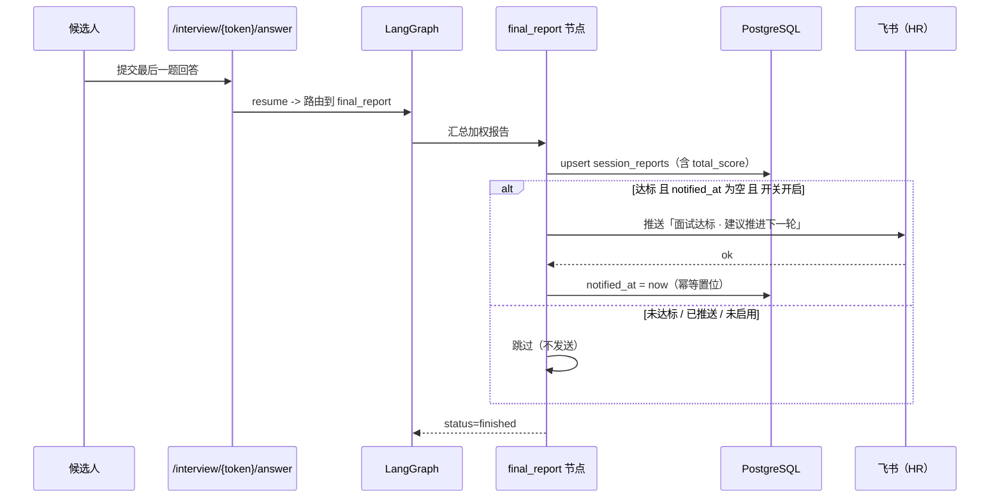

# 飞书 HR 通知接入说明（面试达标自动推送）

> 目标：候选人面试结束后，**综合分 ≥ 阈值**（默认 65，与系统「推荐」档一致）时，
> 系统自动把结果推送到 **HR 的飞书**，让 HR 直接推进下一轮面试。
>
> 适用版本：interview-agent（LangGraph + FastAPI）。相关迁移：`0003_report_notified`。

---

## 1. 触发链路



关键点：

- **挂载点**：`app/graph/nodes/final_report.py::_persist_report`，在报告落库后、`commit` 前调用。
- **幂等**：以 `session_reports.notified_at` 为标记；非空即跳过。重跑 `final_report` 不会重复推送。
- **尽力而为**：整个推送包裹在 `try/except` 中，异常仅写日志（`logger.exception`），
  不影响面试收尾、不影响 `/interview/{token}/answer` 的 `finished` 返回。
- **失败可重试**：发送失败时 `notified_at` 保持 `NULL`，后续重算/重跑会自动再试一次。

---

## 2. 配置项（`.env`，项目根目录）

```bash
# ── 飞书 HR 通知 ───────────────────────────────
FEISHU_NOTIFY_ENABLED=true       # 总开关（false 时完全不触发外部推送）
FEISHU_NOTIFY_THRESHOLD=65       # 触发阈值：综合分 >= 该值即推送
FEISHU_NOTIFY_TRANSPORT=cli      # cli（默认）| api

FEISHU_HR_OPEN_IDS=ou_xxx,ou_yyy # HR 收件人 open_id，多个用英文逗号分隔
FEISHU_HR_DEPARTMENT_IDS=od_xxx   # HR 收件部门 open_department_id，多个逗号分隔（按部门实时解析成员）

# cli 传输（默认）：复用本机已登录的 lark-cli
FEISHU_LARK_CLI_PATH=            # 留空自动探测：PATH -> ~/.workbuddy/binaries/node/versions/*/bin/lark-cli

# api 传输（FEISHU_NOTIFY_TRANSPORT=api 时必填）
FEISHU_APP_ID=
FEISHU_APP_SECRET=

FEISHU_NOTIFY_TIMEOUT=10         # 单次发送超时（秒）
```

派生逻辑（`app/config.py`）：

- `hr_open_id_list`：解析逗号分隔串为列表（忽略空白项）。
- `hr_department_id_list`：解析收件部门串为列表。
- `feishu_notify_ready`：启用 + 有收件人（人或部门）+ 传输凭据齐备 三者同时满足才为 `True`。

---

## 3. 如何确定收件人

### 3.1 按部门收（推荐，适合"整个 HR 部门都收到"）

配置 `FEISHU_HR_DEPARTMENT_IDS` 后，**每次推送时实时解析**该部门的在职成员并逐个私聊：

```bash
# 人力行政部（open_department_id）
FEISHU_HR_DEPARTMENT_IDS=od-3793aaeb88a6124ae8881dc829a129c0
```

- **自动纳入新入职**：成员在飞书组织架构里加了人，下次推送即包含，无需改配置。
- **自动过滤**：已离职 / 已退出 / 冻结 / 未激活的成员会被跳过。
- **解析能力**：由 bot 身份调用 `contact/v3/users/find_by_department`（当前应用已具备该权限）。
- 支持多个部门（逗号分隔）；也可与 `FEISHU_HR_OPEN_IDS` 并用，结果去重。

查部门 `open_department_id`（`od-` 开头）：

```bash
# 顶级部门
lark-cli api GET /open-apis/contact/v3/departments/0/children \
  --params '{"page_size":50,"department_id_type":"open_department_id"}' --as bot --json

# 某部门的子部门（注意用 od- 开头的 open_department_id）
lark-cli api GET "/open-apis/contact/v3/departments/<od-xxx>/children" \
  --params '{"page_size":50,"department_id_type":"open_department_id"}' --as bot --json

# 某部门的成员
lark-cli api GET /open-apis/contact/v3/users/find_by_department \
  --params '{"department_id":"<od-xxx>","department_id_type":"open_department_id","page_size":50}' \
  --as bot --json
```

> 注意：`children` / `find_by_department` 的 `department_id` 参数要传 **`open_department_id`（`od-` 开头）**，
> 传内部 `department_id`（如 `bg3d...`）会报 `99992357 invalid open_department_id`。

### 3.2 按具体的人收

推送需要一个以 `ou_` 开头的 **open_id**。以下方式任选其一。

### 方式 A：给你的飞书应用开权限后按手机号/邮箱兑换（bot 身份）

1. 在开发者后台为应用开通 `contact:user.id:readonly`：
   `https://open.feishu.cn/page/scope-apply?clientID=cli_aa4db80b3f7adbfb&scopes=contact%3Auser.id%3Areadonly`
2. 用接口按手机号/邮箱换取 open_id：

   ```bash
   lark-cli api POST /open-apis/contact/v3/users/batch_get_id \
     --data '{"mobiles":["13800000000"]}' --as bot --json
   ```

   > 当前应用**未开通**该 scope，直接调用会返回 `99991672 app_scope_not_applied`。

### 方式 B：以用户身份登录后按姓名搜索（推荐，最省事）

```bash
# 1) 发起扫码授权（返回 verification_url / device_code，用二维码给用户扫）
lark-cli auth login --scope "contact:user.base:readonly" --no-wait --json

# 2) 用户扫码完成后，再执行（Agent 侧执行，勿让用户自己跑）
lark-cli auth login --device-code <device_code>

# 3) 按姓名搜索，取 open_id
lark-cli contact +search-user --query "张三" --as user --json
```

### 方式 C：直接提供 open_id

若已知 HR 的 open_id（可从飞书管理后台或既有系统导出），直接填入
`FEISHU_HR_OPEN_IDS` 即可，跳过上面两步。

---

## 4. 两种传输方式的取舍

| 维度 | `cli`（默认） | `api` |
| --- | --- | --- |
| 凭据 | 复用本机 `lark-cli` 登录态（应用密钥存于 macOS keychain） | `.env` 中的 `FEISHU_APP_ID` / `FEISHU_APP_SECRET` |
| 适用 | 本机/单机部署、快速联调 | 长期部署的服务端、容器化 |
| 依赖 | 本机需安装并已登录 `lark-cli`；需能访问 keychain | 仅需出网访问 `open.feishu.cn` |
| 风险 | launchd 守护进程访问 keychain 可能受限/弹窗 | 需自行保管应用密钥 |

> 生产建议：先用 `cli` 跑通，再切 `api`（把 `FEISHU_NOTIFY_TRANSPORT=api` 并填好凭据），
> 可彻底摆脱对本机 CLI 与 keychain 的依赖。

**cli 传输的一个关键坑**：`lark-cli` 是 `#!/usr/bin/env node` 脚本，而本项目后端由 launchd
托管、其 PATH 不含 node。因此 `feishu_notify.py` 会把 lark-cli 同目录（内含 node）**注入子进程 PATH**，
并抑制 CLI 的升级提示。这一点在容器/其他守护方式下同样适用。

---

## 5. 上线步骤

```bash
cd backend

# 1) 执行迁移，新增 notified_at 列
.venv/bin/python -m alembic upgrade head

# 2) 填好 .env 的 FEISHU_*（至少：ENABLED=true、HR_OPEN_IDS=ou_xxx）
# 3) 自检通道（不经过面试流程）
.venv/bin/python scripts/send_feishu_test.py --dry-run   # 预览文案与配置
.venv/bin/python scripts/send_feishu_test.py             # 真发一条样例

# 4) 重启后端使配置生效
launchctl kickstart -k gui/$(id -u)/com.benerniang.interview-backend
#   或 bash start.sh
```

> 存量报告默认 `notified_at = NULL`，但**不会**被回溯推送（推送只在 `final_report` 执行时发生），
> 因此上线瞬间不会刷屏。

---

## 6. 排障

| 现象 | 原因 | 处理 |
| --- | --- | --- |
| `230013 Bot has NO availability to this user` | 机器人**可用范围**未覆盖该收件人（或尝试给 bot 自己发） | 开发者后台 → 应用 → 可用范围，把 HR 加入范围；确认收件人是真人而非 bot 自身 |
| `99991672 app_scope_not_applied` | 应用缺少所需 scope | 按错误里的 `console_url` 去后台开通（如 `im:message`、`contact:user.id:readonly`） |
| `未找到 lark-cli 可执行文件` | 本机未装 CLI 或路径不在探测范围 | 设置 `FEISHU_LARK_CLI_PATH` 为绝对路径 |
| `lark-cli 退出码 1 / env: node: No such file` | 子进程 PATH 无 node（launchd 场景） | 代码已自动注入 PATH；若自定义了 CLI 路径请确保同目录有 node，或改用 `api` 传输 |
| keychain 弹窗/无法读取密钥 | launchd 守护进程访问 keychain 受限 | 改用 `FEISHU_NOTIFY_TRANSPORT=api` + `.env` 凭据 |
| 通知没发出去，但面试正常结束 | 未启用 / 未达阈值 / 已推送过 | 查后端日志中的 `飞书 HR 通知处理结果：...` 一行，会明确原因 |

日志示例：

```
INFO  app.graph.nodes.final_report: 飞书 HR 通知处理结果：{'status': 'sent', 'recipients': ['ou_xxx']}
INFO  app.graph.nodes.final_report: 飞书 HR 通知处理结果：{'status': 'skipped', 'reason': '综合分 58.0 未达阈值 65.0'}
```

---

## 7. 服务器部署（腾讯云 Docker）

**结论：可以真实推送，但必须把传输切成 `api`。**

### 7.1 为什么不能直接用默认的 `cli` 传输

| 依赖 | 本机现状 | 服务器（Linux 容器） |
| --- | --- | --- |
| `lark-cli` 二进制 | 已安装 | 需额外安装 |
| `node` 运行时 | 有（launchd PATH 里没有，代码已兜底注入） | 容器内没有 |
| macOS keychain 里的 App Secret | CLI 自己读得到 | **没有 keychain，读不到** |

第三条是硬伤：`cli` 传输靠 CLI 去 keychain 取应用密钥，Linux 容器里没有 macOS keychain，
**部门解析和发送都会失败**。

### 7.2 服务器配置清单

```bash
# .env（服务端）
FEISHU_NOTIFY_ENABLED=true
FEISHU_NOTIFY_TRANSPORT=api          # ← 关键：切到 Open API 直连
FEISHU_NOTIFY_THRESHOLD=65
FEISHU_HR_DEPARTMENT_IDS=od-3793aaeb88a6124ae8881dc829a129c0

# 自建应用凭据（飞书开发者后台 → 凭证与基础信息）
FEISHU_APP_ID=cli_aa4db80b3f7adbfb
FEISHU_APP_SECRET=<App Secret>

FEISHU_NOTIFY_TIMEOUT=10
```

代码侧已保证：切到 `api` 后，**发送与部门成员解析都走 httpx 直连**，不再依赖
lark-cli / node / keychain；`tenant_access_token` 带进程内缓存（提前 5 分钟过期），
一次通知只换一次令牌。

### 7.3 飞书侧前置条件

1. 应用 `cli_aa4db80b3f7adbfb`（笨二娘人事中台）需已开通：
   - `im:message`（发消息）
   - 读部门成员的 contact 权限（当前已具备）
2. **机器人可用范围**必须覆盖收件人（否则报 `230013 Bot has NO availability to this user`）
3. 容器需能出网访问 `open.feishu.cn:443`

### 7.4 Docker 注意

- `docker-compose.yml` 的 `api` 服务用 `env_file: .env` 注入，把上面的 `FEISHU_*` 写进项目根
  `.env` 即可（该文件已被 git 忽略，不会进仓库）。
- `web` / 前端服务不需要这些变量。
- 容器启动时会执行 `alembic upgrade head`，`notified_at` 列会自动建好。

### 7.5 部署后自检

```bash
docker compose exec api python scripts/send_feishu_test.py --dry-run
docker compose exec api python scripts/send_feishu_test.py
```

### 7.6 已验证 / 未验证

- **已验证**：
  - 阈值判定、幂等（`notified_at`）、文案构造；
  - 按部门解析（含翻页、在职过滤、多部门、与显式 open_id 合并去重）；
  - `api` 传输的完整 HTTP 契约——换令牌、查部门成员、发消息的请求构造，
    用本地 mock 飞书服务逐项核对（含 `tenant_access_token` 只换一次、Bearer 头、
    `msg_type=interactive` 的 Markdown 卡片结构）；
  - `cli` 传输已对真实飞书发通（方玺、赵江荷均收到）。
- **未验证**：`api` 传输用**真实 App Secret** 打真实飞书——密钥存在 macOS keychain 里、
  ACL 不允许外部读取。部署时填好 `FEISHU_APP_SECRET` 后跑一次
  `scripts/send_feishu_test.py` 即可确认。

> 消息形态：`cli` 传输用 lark-cli 的 `--markdown`，`api` 传输用 `msg_type=interactive`
> 的 Markdown 卡片，两者观感一致。

---

## 8. 代码位置

| 文件 | 作用 |
| --- | --- |
| `app/services/feishu_notify.py` | 通知服务：阈值判定、消息构造、cli/api 双传输、幂等编排 |
| `app/graph/nodes/final_report.py` | 挂载点：报告落库后触发推送（异常兜底） |
| `app/config.py` | `FEISHU_*` 配置项与派生属性 |
| `app/db/models/report.py` + `alembic/versions/0003_report_notified.py` | `notified_at` 幂等字段 |
| `scripts/send_feishu_test.py` | 通道自检脚本 |
| `tests/test_feishu_notify.py` | 单元测试（阈值/文案/幂等/多收件人/CLI 契约解析） |
